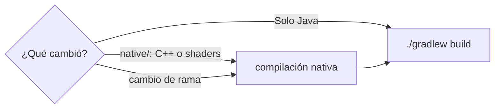

# Contribuir a Radiante

Gracias por ayudar. Son bienvenidos los reportes de errores, las traducciones, los paquetes de shaders, la
documentación y el código.

Idiomas: [EN](CONTRIBUTING.md) · **ES** · Enlaces: [Issues](https://github.com/Gabrieli2806/Radiante/issues) ·
[Discord](https://discord.gg/DhBbAzugZ9) · [Documentación de desarrollo](docs/dev/README.md) (en inglés)

**Contenido:** 1. [Cómo ayudar](#1-cómo-ayudar) · 2. [Antes de empezar](#2-antes-de-empezar) ·
3. [El proyecto](#3-el-proyecto) · 4. [Compilar](#4-compilar) · 5. [Probar tu cambio](#5-probar-tu-cambio) ·
6. [Escribir código](#6-escribir-código) · 7. [Ramas](#7-ramas) · 8. [Uso de herramientas de IA](#8-uso-de-herramientas-de-ia) ·
9. [Commits](#9-commits) · 10. [Pull requests](#10-pull-requests) · 11. [Versiones y publicaciones](#11-versiones-y-publicaciones) ·
12. [Licencia](#12-licencia)

## 1. Cómo ayudar

| Quieres | Haz esto |
|---|---|
| Reportar un error o crash | Abre un [issue](https://github.com/Gabrieli2806/Radiante/issues/new/choose) con el formulario; adjunta `logs/latest.log` |
| Proponer una idea | Usa el formulario de propuestas. Las grandes direcciones son los issues con la etiqueta `roadmap` |
| Traducir | Los textos están en `common/src/main/resources/assets/radiante/lang/` (`en_us`, `es_es`, `zh_cn`); la documentación en `docs/en` y `docs/es` |
| Crear un aspecto | Haz un [paquete de shaders](docs/es/paquetes-de-shaders.md), no un ajuste nuevo |
| Escribir código | Elige un issue abierto, o abre uno antes para algo grande |

## 2. Antes de empezar

- **Revisa los issues abiertos.** Tu error o idea puede estar ya reportado, en marcha, o tener notas de lo que se
  probó.
- **Habla primero de los cambios grandes** (pases de render nuevos, escaladores, la interfaz de los paquetes de
  shaders, trabajo con loaders), en un issue o en [Discord](https://discord.gg/DhBbAzugZ9).
- **Apunta en el issue lo que encuentres**, también lo que no funcionó.

## 3. El proyecto

Radiante tiene dos mitades: el **mod Java** recoge el mundo y los ajustes, y **PrismRT**, un renderizador en
C++/Vulkan, lo traza sobre el propio dispositivo Vulkan de Minecraft. El trazador en sí es el paquete de shaders
incluido en PrismRT, **radiante-pt**.

| Dónde | Qué |
|---|---|
| `common/` | Todo lo que es Minecraft puro: mixins, ajustes, pantallas, recogida del mundo. Sin código de loader. |
| `fabric/`, `neoforge/`, `forge/` | El pequeño punto de entrada de cada loader y su implementación de `RadiantePlatform` |
| `common/src/main/resources/assets/radiante/lang/` | Los textos que ve el jugador |
| `native/src/prism/` | El renderizador ([arquitectura](docs/dev/architecture.md)) |
| `native/src/shader/world/ray_tracing/internal/radiante-pt/` | El trazador, y los hooks que reemplazan los paquetes de shaders |
| `examples/shaderpacks/` | Paquetes de shaders de ejemplo |
| `docs/en`, `docs/es`, `docs/dev` | Documentación para jugadores (dos idiomas) y de desarrollo |

[AGENTS.md](AGENTS.md) tiene un mapa más fino del código.

## 4. Compilar

Necesitas Java 25, el Vulkan SDK 1.4.341+, Visual Studio 2026 con C++ (Windows) o cmake, ninja y g++ 13+ (Linux), y
las librerías del DLSS SDK. Preparación completa: [Building](docs/dev/building.md) (en inglés).

```sh
native/build-windows.bat      # el renderizador (Linux: native/build-linux.sh)
./gradlew build               # el mod: un jar por loader en */build/libs
./gradlew :fabric:runClient   # un cliente de desarrollo (también :neoforge:, :forge:)
```

> [!IMPORTANT]
> Gradle no recompila el renderizador, y lo que genera no está en git. Repite la compilación nativa tras cualquier
> cambio en `native/` y tras cada cambio de rama, o el juego usará el renderizador y los shaders viejos.



`./gradlew build` regenera las cabeceras JNI de `native/include/`: revierte esos cambios antes de hacer commit, salvo
que formen parte de tu cambio.

## 5. Probar tu cambio

- **Prueba en un mundo cuyo nombre empiece por `Radiante`**, nunca en uno en el que juegues.
- **Reproduce un error antes de arreglarlo**, y compara capturas de **la misma vista** antes y después.
- **Abre el juego tras tocar un mixin.** Un mixin con un objetivo equivocado compila bien y solo falla en el juego.
- **Di claramente qué no comprobaste.**

Ejecuciones con scripts, mundos de prueba, archivos de ajustes y tests: [Testing](docs/dev/testing.md) (en inglés).

## 6. Escribir código

- **Nada de código de loader en `common/`.** Lo que cambie según el loader va detrás de `RadiantePlatform`.
- **Los comentarios explican el porqué,** con frases completas, al estilo del código de alrededor.
- **Arregla la compatibilidad en general.** Si un mod se rompe porque Radiante se salta algo que hace vanilla,
  restaura ese comportamiento para todos los mods en vez de tratar uno aparte. Un parche para un mod concreto es el
  último recurso, y opcional (reflexión, sin dependencia obligatoria).
- **Los valores por defecto de radiante-pt son el aspecto de Bedrock RTX.** Cambiar uno es cambiar a la vez
  `configs.json` (o `tone_mapping.yaml`) y `BedrockRtxValues`; un test comprueba que coinciden. Otros aspectos son
  paquetes de shaders.
- **Los archivos de hooks y `common/pack_*.glsl` son la interfaz de los paquetes de shaders** (`radiante-pt@1`):
  mantén sus firmas. Ver [Shader packs: design](docs/dev/shader-packs.md) (en inglés).

**Textos:** cada texto que ve el jugador va en los tres archivos de idioma, con las mismas claves, los mismos `%s` y
los mismos `\n`. Si no puedes traducir uno, copia el inglés y dilo en el pull request. Los tooltips son cortos: qué
hace, y qué pasa al subirlo o bajarlo.

**Un ajuste nuevo** suele necesitar: el atributo en el `configs.json` de radiante-pt (`"runtime": true` si puede
cambiar sin recompilar), un `Tunable` o una fila en `SettingsRows`, su `OptionImpact`, los tres archivos de
idioma, su página de ajustes en `docs/en` y `docs/es`, y una línea en `changelog.md`.

## 7. Ramas

- Una rama por versión de Minecraft: `mc/26.2`, `mc/26.3` (la principal) y `mc/26.4`. No hay `main`.
- **Trabaja sobre `mc/26.3`**, en una rama con el nombre del cambio (`fix/rain-motion-vectors`,
  `feat/end-crystal-tint`).
- El mantenedor lleva los cambios aceptados a las otras versiones. Si sabes que tu cambio se comporta distinto ahí,
  dilo.

## 8. Uso de herramientas de IA

Los asistentes de programación con IA son bienvenidos; partes de Radiante se escriben con ellos. Se aplica el mismo
estándar a todo el código:

- **Tú eres el autor.** Entiende cada línea que envías y sé capaz de explicar por qué está ahí.
- **Pruébalo de verdad:** compílalo, ábrelo en el juego, compara antes y después. Que compile no basta.
- **Comprueba lo que afirma.** Los asistentes inventan métodos, objetivos de mixin y resultados. Verifícalo contra el
  jar de Minecraft, el código y el juego.
- **No te salgas del alcance.** Quita reescrituras, reformateos y comentarios que solo repiten el código.
- **Respeta las licencias.** No envíes código generado copiado de un proyecto con una licencia incompatible.

Los pull requests que claramente no se ejecutaron, o cuyo autor no puede responder preguntas sobre ellos, se
cerrarán.

## 9. Commits

- Asunto: corto, en minúsculas y en inglés, `área: qué cambió`. Por ejemplo
  `render: mark thin surfaces, which let light through`.
- Cuerpo, si el motivo no es evidente: por qué, con frases completas.
- Sin líneas de atribución a la IA (`Co-Authored-By` de herramientas de IA, "Generated with ...").
- `fixes #<n>` solo cuando el arreglo está comprobado en el juego; si no, solo `#<n>`.

## 10. Pull requests

Rellena la plantilla: qué cambió y por qué, cómo lo probaste y qué no comprobaste. Antes de abrirlo:

- [ ] Basado en `mc/26.3`
- [ ] Compilación nativa hecha si cambió algo en `native/`; `./gradlew build` pasa
- [ ] `python native/src/tools/check_shaders.py` pasa, si cambió algún shader
- [ ] Probado en el juego en un mundo `Radiante*`; capturas de antes y después si es un cambio visual
- [ ] Textos en los tres archivos de idioma; documentación y `changelog.md` actualizados si el jugador lo notará
- [ ] Sin cambios ajenos, y sin las cabeceras regeneradas de `native/include/`

La CI compila cada pull request (los dos renderizadores, todos los loaders) pero nunca publica. Los cambios suelen
combinarse en un solo commit que te mantiene como autor.

## 11. Versiones y publicaciones

Solo el mantenedor cambia versiones. En un pull request, **no cambies**:

- `mod_version` en `gradle.properties`: subir un valor nuevo publica una versión.
- Las versiones de Minecraft, de los loaders o de las librerías en `gradle.properties`.
- Los encabezados de versión de `changelog.md`: añade tu línea bajo `## [Unreleased]`.

Si tu cambio necesita una versión más nueva de algo, dilo en el pull request.

## 12. Licencia

Radiante es GPL-3.0 con [permisos adicionales](LICENSE-EXCEPTION.md) para distribuirlo con las librerías de NVIDIA e
Intel, y para que los paquetes de shaders que usan solo su interfaz para paquetes (`radiante/v1`, los hooks de
Radiante PT) conserven su propia licencia. Al contribuir, aceptas que tu contribución tenga la misma licencia. Esa
interfaz se escribe desde cero: nada copiado de Radiance, MCVR ni otros proyectos, para que el permiso la cubra.
Indica de dónde sale cualquier cosa que adaptes de otro proyecto.
