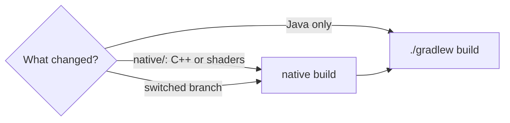

# Contributing to Radiante

Thanks for helping. Bug reports, translations, shader packs, documentation and code are all welcome.

Languages: **EN** · [ES](CONTRIBUTING.es.md) · Quick links: [Issues](https://github.com/Gabrieli2806/Radiante/issues) ·
[Discord](https://discord.gg/DhBbAzugZ9) · [Developer docs](docs/dev/README.md)

**Contents:** 1. [Ways to help](#1-ways-to-help) · 2. [Before you start](#2-before-you-start) ·
3. [The project](#3-the-project) · 4. [Build](#4-build) · 5. [Test your change](#5-test-your-change) ·
6. [Writing code](#6-writing-code) · 7. [Branches](#7-branches) · 8. [Using AI tools](#8-using-ai-tools) ·
9. [Commits](#9-commits) · 10. [Pull requests](#10-pull-requests) · 11. [Versions and releases](#11-versions-and-releases) ·
12. [Licence](#12-licence)

## 1. Ways to help

| You want to | Do this |
|---|---|
| Report a bug or crash | Open an [issue](https://github.com/Gabrieli2806/Radiante/issues/new/choose) with the form; attach `logs/latest.log` |
| Suggest an idea | Use the feature request form. Big directions are the issues labelled `roadmap` |
| Translate | Texts are in `common/src/main/resources/assets/radiante/lang/` (`en_us`, `es_es`, `zh_cn`); docs in `docs/en` and `docs/es` |
| Make a look | Make a [shader pack](docs/en/shader-packs.md), not a new setting |
| Write code | Pick an open issue, or open one first for anything large |

## 2. Before you start

- **Check the open issues.** Your bug or idea may already be known, in progress, or have notes on what was tried.
- **Talk first about big changes** (new render passes, upscaler backends, the shader pack interface, loader work), in
  an issue or on [Discord](https://discord.gg/DhBbAzugZ9).
- **Write down what you find in the issue**, dead ends included.

## 3. The project

Radiante has two halves: the **Java mod** collects the world and the settings, and **PrismRT**, a C++/Vulkan
renderer, traces it on Minecraft's own Vulkan device. The path tracer itself is PrismRT's built-in shader pack,
**radiante-pt**.

| Where | What |
|---|---|
| `common/` | Everything that is plain Minecraft: mixins, settings, screens, collection of the world. No loader code. |
| `fabric/`, `neoforge/`, `forge/` | Each loader's small entrypoint and its `RadiantePlatform` implementation |
| `common/.../compat/VersionCompat.java` | Where Minecraft's API differs between versions: the same methods on every version branch, each with its own bodies |
| `common/src/main/resources/assets/radiante/lang/` | Player-facing texts |
| `native/src/prism/` | The renderer ([architecture](docs/dev/architecture.md)) |
| `native/src/shader/world/ray_tracing/internal/radiante-pt/` | The path tracer, and the hooks shader packs replace |
| `examples/shaderpacks/` | Example shader packs |
| `docs/en`, `docs/es`, `docs/dev` | Player docs (two languages) and developer docs |

[AGENTS.md](AGENTS.md) has a finer map of the code.

## 4. Build

You need Java 25, the Vulkan SDK 1.4.341+, Visual Studio 2026 with C++ (Windows) or cmake, ninja and g++ 13+ (Linux),
and the DLSS SDK libraries. Full setup: [Building](docs/dev/building.md).

```sh
native/build-windows.bat      # the renderer (Linux: native/build-linux.sh)
./gradlew build               # the mod: one jar per loader in */build/libs
./gradlew :fabric:runClient   # a development client (also :neoforge:, :forge:)
```

> [!IMPORTANT]
> Gradle does not rebuild the renderer, and its output is not in git. Run the native build again after any change
> under `native/` and after every branch switch, or the game runs the old renderer and shaders.



`./gradlew build` regenerates the JNI headers in `native/include/`: revert them before committing unless they are
part of your change.

## 5. Test your change

- **Test in a world whose name starts with `Radiante`**, never in one you play in.
- **Reproduce a bug before fixing it**, and compare screenshots of the **same view** before and after.
- **Launch the game after touching a mixin.** A wrong mixin target compiles fine and only fails in game.
- **Say plainly what you did not check.**

Scripted runs, test worlds, settings files and unit tests: [Testing](docs/dev/testing.md).

## 6. Writing code

- **Keep `common/` free of loader code.** Behaviour that differs per loader goes behind `RadiantePlatform`.
- **Comments explain why,** in full sentences, in the style of the code around them.
- **API differences between Minecraft versions go in `VersionCompat`,** not inline: a small static method named
  for what it does, with the same signature on every version branch (`mc/26.2`, `mc/26.3`, `mc/26.4`) and that
  version's body. The class that calls it stays the same file on every branch, so changes merge across without
  conflicts. Mixins and accessors are a version's own and stay as they are.
- **Fix compatibility generally.** If a mod breaks because Radiante skips something vanilla does, restore that
  behaviour for every mod instead of special-casing one. A mod-specific patch is the last resort, and optional
  (reflection, no hard dependency).
- **radiante-pt's defaults are the Bedrock RTX look.** Changing one means changing `configs.json` (or
  `tone_mapping.yaml`) and `BedrockRtxValues` together; a test checks they agree. Other looks are shader packs.
- **The hook files and `common/pack_*.glsl` are the shader pack interface** (`radiante-pt@1`): keep their
  signatures. See [Shader packs: design](docs/dev/shader-packs.md).

**Texts:** every player-facing text goes in all three lang files, with the same keys, `%s` placeholders and `\n`.
If you cannot translate one, copy the English and say so in the pull request. Tooltips stay short: what it does, and
what raising or lowering it does.

**A new setting** usually needs: the attribute in radiante-pt's `configs.json` (`"runtime": true` if it can change
without a rebuild), a `Tunable` or a row in `SettingsRows`, its `OptionImpact`, the three lang files, its
settings page in `docs/en` and `docs/es`, and a line in `changelog.md`.

## 7. Branches

- One branch per Minecraft version: `mc/26.2`, `mc/26.3` (the default) and `mc/26.4`. There is no `main`.
- **Work on `mc/26.3`**, in a branch named after the change (`fix/rain-motion-vectors`, `feat/end-crystal-tint`).
- The maintainer ports merged changes to the other versions. If you know your change behaves differently there, say
  so.

## 8. Using AI tools

AI coding assistants are welcome; parts of Radiante are written with them. The same standard applies to all code:

- **You are the author.** Understand every line you submit and be able to explain why it is there.
- **Test it for real:** build it, run it in game, compare before and after. Compiling is not enough.
- **Check what it claims.** Assistants invent API methods, mixin targets and results. Verify against the Minecraft
  jar, the code and the game.
- **Keep it in scope.** Remove unrelated rewrites, reformatting and comments that only repeat the code.
- **Respect licences.** Do not submit generated code copied from an incompatible project.

Pull requests that were plainly not run, or whose author cannot answer questions about them, will be closed.

## 9. Commits

- Subject: short, lowercase, `area: what changed`. For example `render: mark thin surfaces, which let light through`.
- Body, when the reason is not obvious: why, in full sentences.
- No AI attribution lines (`Co-Authored-By` for AI tools, "Generated with ..." trailers).
- `fixes #<n>` only when the fix is verified in game; otherwise just `#<n>`.

## 10. Pull requests

Fill in the template: what changed and why, how you tested it, and what you did not check. Before opening:

- [ ] Based on `mc/26.3`
- [ ] Native build run, if anything under `native/` changed; `./gradlew build` passes
- [ ] `python native/src/tools/check_shaders.py` passes, if a shader changed
- [ ] Run in game in a `Radiante*` test world; screenshots before and after for visual changes
- [ ] Texts in all three lang files; docs and `changelog.md` updated where players will notice
- [ ] No unrelated changes, and no regenerated `native/include/` headers

CI builds every pull request (both renderers, every loader) but never publishes. Changes are usually squashed into
one commit that keeps you as the author.

## 11. Versions and releases

Only the maintainer changes versions. In a pull request, **do not change**:

- `mod_version` in `gradle.properties`: pushing a new value publishes a release.
- The Minecraft, loader or library versions in `gradle.properties`.
- The version headings in `changelog.md`: add your line under `## [Unreleased]`.

If your change needs a newer version of something, say so in the pull request.

## 12. Licence

Radiante is GPL-3.0 with [additional permissions](LICENSE-EXCEPTION.md) to ship it with the NVIDIA and Intel runtime
libraries, and to let shader packs that use only its pack interface (`radiante/v1`, Radiante PT's hooks) keep their
own licence. By contributing, you agree your contribution is licensed the same way. Write that interface from
scratch: nothing copied from Radiance, MCVR or other projects, so the permission can cover it. Name the source of
anything you adapt from another project.
