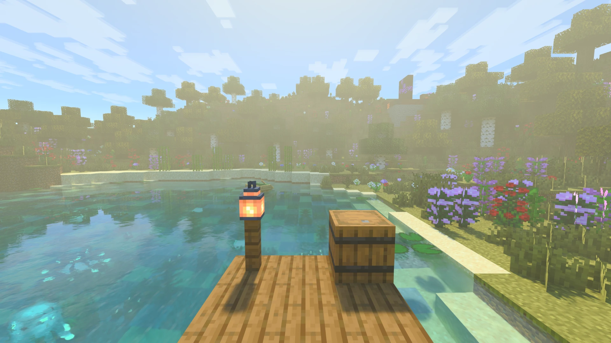
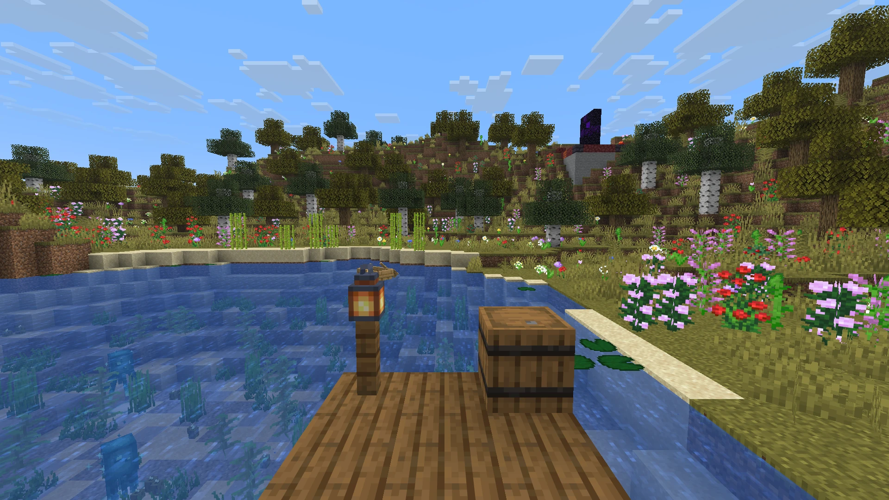
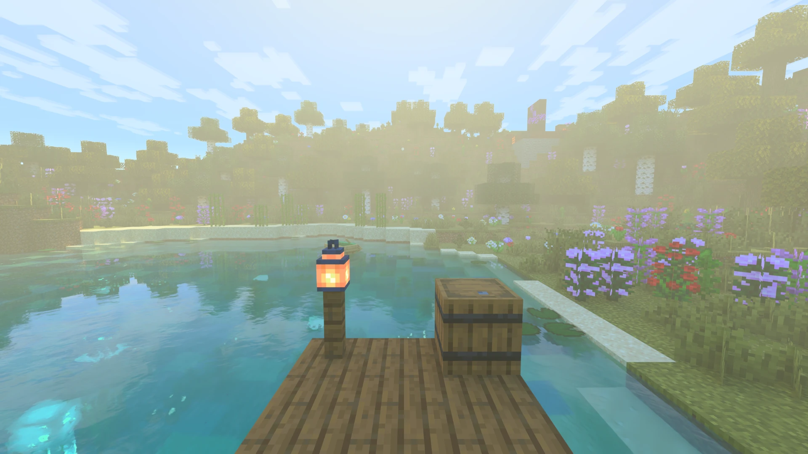
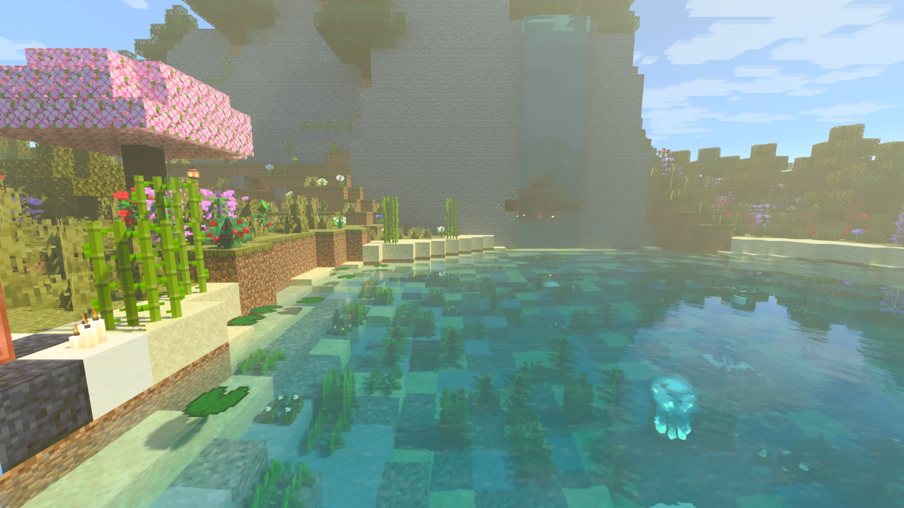
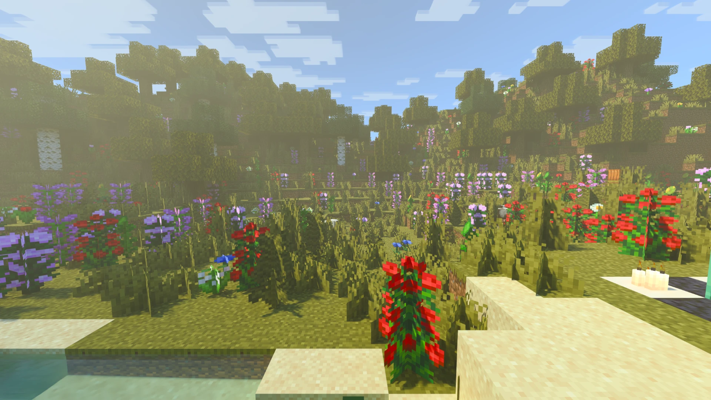
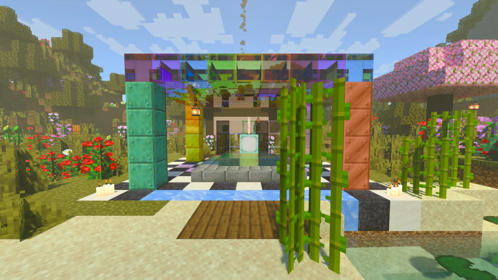
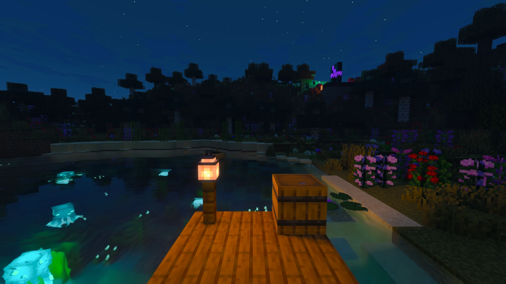

# Radiante

**Path tracing para Minecraft Java**, sobre el propio backend Vulkan de Minecraft. Para Minecraft 26.3 (Fabric,
NeoForge y Forge), 26.2 (Fabric, NeoForge y Forge) y las snapshots de 26.4 (Fabric).

[Modrinth](https://modrinth.com/project/radiante) · [CurseForge](https://www.curseforge.com/minecraft/mc-mods/radiante) ·
[Discord](https://discord.gg/DhBbAzugZ9) · [Documentación](docs/es/README.md) ·
[Issues](https://github.com/Gabrieli2806/Radiante/issues) · Idiomas: [EN](README.md) · **ES**

| Trazado de rayos apagado (vanilla) | Trazado de rayos encendido (DLSS Quality) |
|---|---|
|  |  |

| | |
|---|---|
|  |  |
|  |  |

## Características

- **Path tracing** de todo el mundo: luz del sol, sombras, luz rebotada, reflejos y luces de bloque, en
  Windows y Linux.
- **El aspecto de Bedrock RTX** por defecto, y lectura directa de resource packs `.mcpack` de Bedrock RTX. También
  packs LabPBR.
- **Cielo y clima:** cielo físico, niebla y nubes volumétricas, lluvia con suelo mojado y charcos, un ambiente propio
  para cada bioma.
- **Escaladores:** FSR incluido; DLSS (con Reconstrucción de Rayos) y XeSS se descargan en el juego. Generación de
  fotogramas hasta 4x y NVIDIA Reflex.
- **Salida HDR**, desenfoque de movimiento y profundidad de campo.
- **Paquetes de shaders** para crear tu propio aspecto con path tracing, y **presets** para guardar y compartir el
  tuyo.
- **Distant Horizons:** su terreno lejano también se traza (experimental).
- **Ligero:** unos 15 MB por loader. Funciona sobre el dispositivo Vulkan que Minecraft ya crea.

## Requisitos

- Una GPU con trazado de rayos en Vulkan: NVIDIA RTX 20+, AMD RX 6000+ o Intel Arc.
- Windows 10/11 x64, o Linux x86-64 con glibc 2.35+.
- Java 25, y Fabric (con Fabric API), NeoForge o Forge.

Versiones exactas: [Primeros pasos](docs/es/primeros-pasos.md).

## Instalar

1. Instala Fabric (con Fabric API), NeoForge o Forge para tu versión de Minecraft.
2. Pon el jar de Radiante de ese loader en `mods`.
3. Abre el juego y entra en un mundo. Pulsa `F6` para los ajustes de Radiante.

¿Algo no funciona? Mira [Solución de problemas](docs/es/solucion-de-problemas.md).

## Documentación

| Para | Empieza aquí |
|---|---|
| Jugadores | [Documentación](docs/es/README.md): ajustes, escaladores, HDR, packs de Bedrock, solución de problemas |
| Autores de mods | [Hacer mods para Radiante](docs/es/api.md) |
| Autores de paquetes de shaders | [Crear un paquete de shaders](docs/es/paquetes-de-shaders.md) |
| Quien contribuye | [CONTRIBUTING.es.md](CONTRIBUTING.es.md) y la [documentación de desarrollo](docs/dev/README.md) (en inglés) |

## Licencia

[GPL-3.0](LICENSE), con [permisos adicionales](LICENSE-EXCEPTION.md) para las librerías de NVIDIA e Intel y para los paquetes de
shaders, que conservan su propia licencia si usan solo la interfaz para paquetes de Radiante. Radiante comenzó como un
fork de Radiance y su renderer MCVR. Desde entonces se ha rehecho buena parte, y el proyecto sigue alejándose de ellos.

Radiante no está afiliado, respaldado ni patrocinado por Mojang, Microsoft ni NVIDIA. Minecraft, Minecraft Bedrock,
Bedrock RTX y NVIDIA son marcas de sus dueños; sus nombres se usan solo para describir la compatibilidad con sus
resource packs y el aspecto al que aspiran los valores por defecto de radiante-pt.
