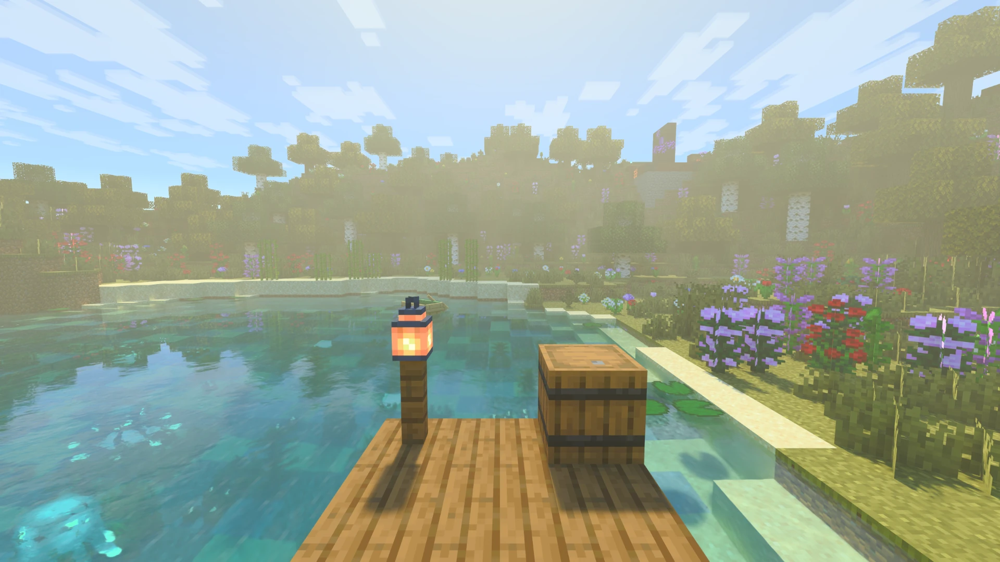
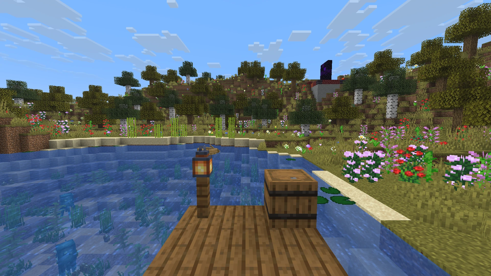
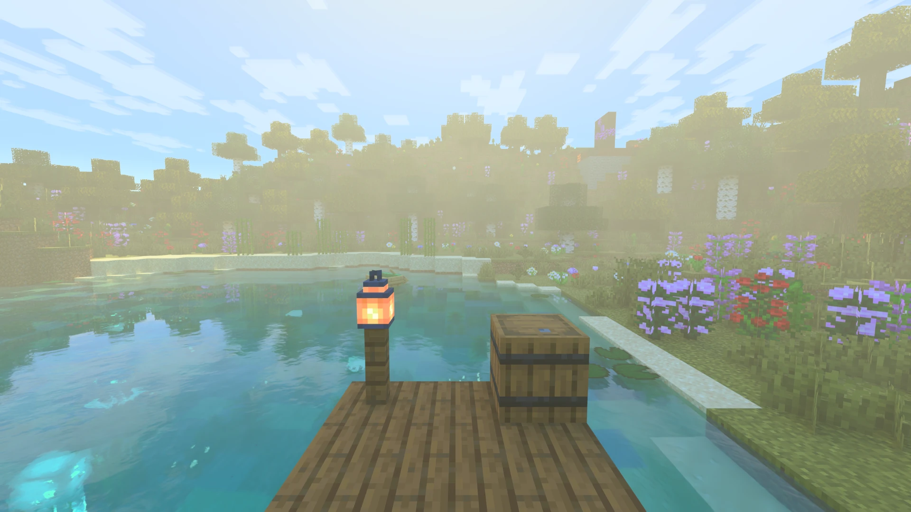
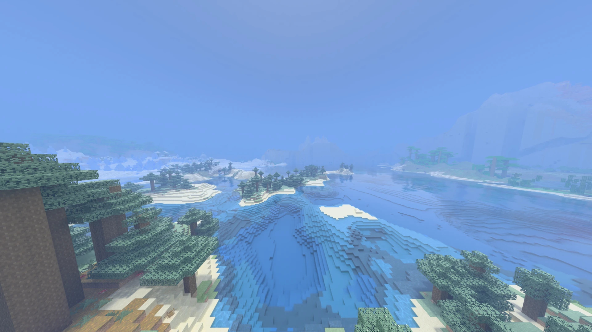
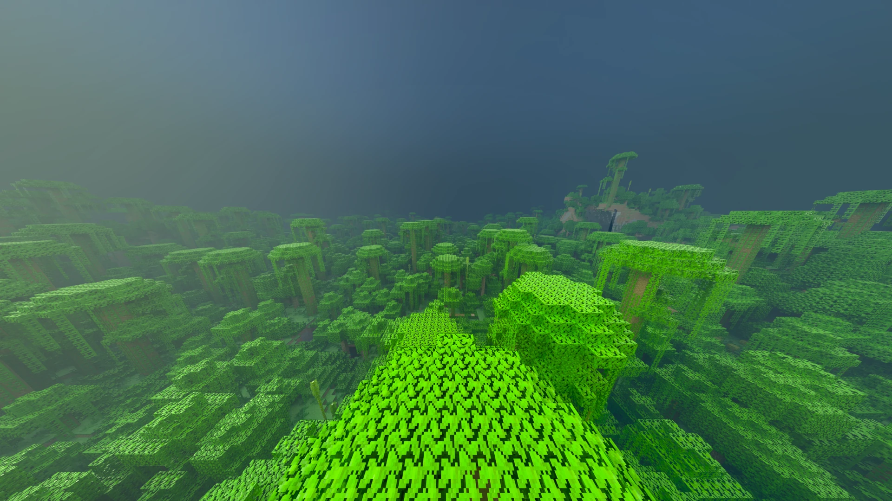
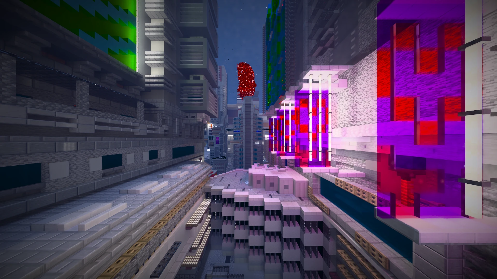
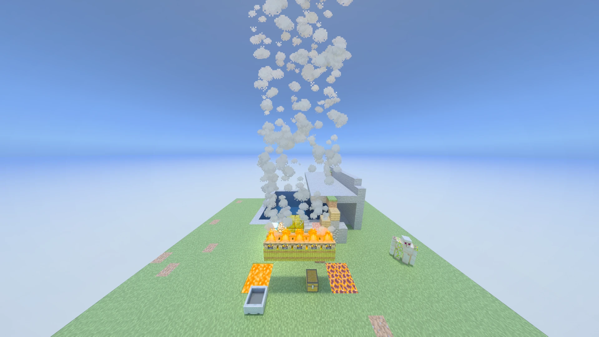

# Radiante

**Path-traced rendering for Minecraft Java**, on Minecraft's own Vulkan backend. For Minecraft 26.3 (Fabric,
NeoForge and Forge), 26.2 (Fabric, NeoForge and Forge) and 26.4 snapshots (Fabric).

[Modrinth](https://modrinth.com/project/radiante) · [CurseForge](https://www.curseforge.com/minecraft/mc-mods/radiante) ·
[Discord](https://discord.gg/DhBbAzugZ9) · [Documentation](docs/en/README.md) ·
[Issues](https://github.com/Gabrieli2806/Radiante/issues) · Languages: **EN** · [ES](README.es.md)

| Ray tracing off (vanilla) | Ray tracing on (DLSS Quality) |
|---|---|
|  |  |

| | |
|---|---|
|  |  |
|  |  |

## Features

- **Path tracing** of the whole world: sunlight, shadows, bounced light, reflections and block lights, on
  Windows and Linux.
- **The Bedrock RTX look** by default, and Bedrock RTX `.mcpack` resource packs read directly. LabPBR packs too.
- **Sky and weather:** physical sky, volumetric fog and clouds, rain with wet ground and puddles, a look of its own
  for every biome.
- **Upscalers:** FSR built in; DLSS (with Ray Reconstruction) and XeSS downloaded in game. Frame generation up to 4x
  and NVIDIA Reflex.
- **HDR output**, motion blur and depth of field.
- **Shader packs** to make your own path-traced look, and **presets** to save and share yours.
- **Distant Horizons** far terrain, traced too (experimental).
- **Light:** about 15 MB per loader. It runs on the Vulkan device Minecraft already creates.

## Requirements

- A GPU with Vulkan ray tracing: NVIDIA RTX 20+, AMD RX 6000+ or Intel Arc.
- Windows 10/11 x64, or Linux x86-64 with glibc 2.35+.
- Java 25, and Fabric (with Fabric API), NeoForge or Forge.

Exact versions: [Getting started](docs/en/getting-started.md).

## Install

1. Install Fabric (with Fabric API), NeoForge or Forge for your Minecraft version.
2. Put the Radiante jar for that loader in `mods`.
3. Start the game and enter a world. Press `F6` for Radiante's settings.

Something not working? See [Troubleshooting](docs/en/troubleshooting.md).

## Documentation

| For | Start here |
|---|---|
| Players | [Documentation](docs/en/README.md): settings, upscalers, HDR, Bedrock packs, troubleshooting |
| Mod authors | [Making mods for Radiante](docs/en/api.md) |
| Shader pack authors | [Making a shader pack](docs/en/shader-packs.md) |
| Contributors | [CONTRIBUTING.md](CONTRIBUTING.md) and the [developer docs](docs/dev/README.md) |

## Licence

GPL-3.0, with [additional permissions](LICENSE-EXCEPTION.md) for the NVIDIA and Intel runtime libraries and for shader
packs, which keep their own licence when they use only Radiante's pack interface. Radiante began as a fork of Radiance
and its MCVR renderer. Much of it has been rebuilt since, and the project keeps moving further away from them.

Radiante is not affiliated with, endorsed by or sponsored by Mojang, Microsoft or NVIDIA. Minecraft, Minecraft Bedrock,
Bedrock RTX and NVIDIA are trademarks of their owners; their names are used only to describe compatibility with
their resource packs and the look radiante-pt's defaults aim for.
