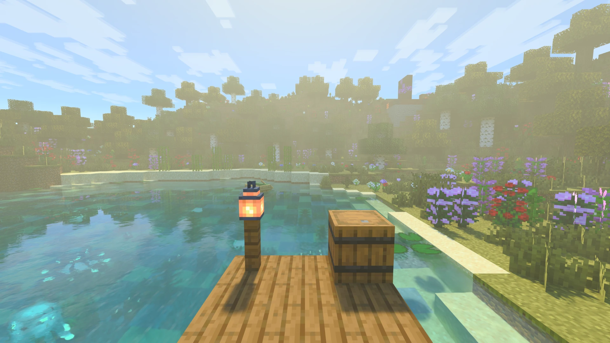

# Radiante documentation

Languages: **EN** · [ES](../es/README.md)

Radiante is a path tracing mod for Minecraft Java. These pages describe the 26.3 version; the 26.2 and 26.4 builds
work the same.

## Playing

| Page | What it covers |
|---|---|
| [Getting started](getting-started.md) | Requirements, installation, first start, keys |
| [Settings](settings.md) | The settings screen, presets and shader packs, with a page per section |
| [Quality and performance](quality-and-performance.md) | Quality levels, what costs the most FPS, stutter and VRAM |
| [Upscalers, frame generation and Reflex](upscalers.md) | FSR, DLSS and XeSS, installing them, frame generation, Reflex |
| [HDR](hdr.md) | Turning HDR on and calibrating it |
| [Bedrock RTX](bedrock-rtx.md) | Bedrock `.mcpack` packs and the Bedrock RTX look |
| [Distant Horizons](distant-horizons.md) | Far terrain, traced (experimental) |
| [Troubleshooting](troubleshooting.md) | Start-up screens, upscalers, HDR, Linux, slow or wrong picture |

## Settings by section

[Quality](settings/quality-and-upscaling.md) · [Image](settings/image.md) · [Lighting](settings/lighting.md) ·
[Sky & Water](settings/sky-fog-water.md) · [Performance](settings/performance.md) ·
[Other and Debug](settings/other-and-debug.md)

## Making things for Radiante

| Page | What it covers |
|---|---|
| [Making mods for Radiante](api.md) | The public API: ray tracing state, the sun, your own geometry, your options in Radiante's settings |
| [Making a shader pack](shader-packs.md) | Your own path-traced look on top of Radiante PT |
| [Contributing](../../CONTRIBUTING.md) | Building Radiante, testing a change, opening a pull request |

## Known limitations

- The FSR, XeSS and native pipelines are noisier than DLSS Ray Reconstruction.
- AMD and Intel work, but are tested less than NVIDIA.
- Frame generation is not available with HDR. XeSS is Windows only.
- Distant Horizons support is experimental.

Bugs and ideas are in [GitHub Issues](https://github.com/Gabrieli2806/Radiante/issues); where the project is going,
in the [roadmap issues](https://github.com/Gabrieli2806/Radiante/issues?q=is%3Aopen+label%3Aroadmap).

## Links

[GitHub](https://github.com/Gabrieli2806/Radiante) · [Modrinth](https://modrinth.com/project/radiante) ·
[CurseForge](https://www.curseforge.com/minecraft/mc-mods/radiante) · [Discord](https://discord.gg/DhBbAzugZ9) ·
[Ko-fi](https://ko-fi.com/gabrieli2806)
