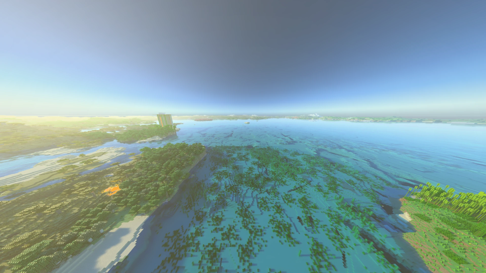

[← Back to index](README.md)

# Distant Horizons (experimental)

[Distant Horizons](https://modrinth.com/mod/distanthorizons) shows terrain far beyond the normal render distance.
With it installed, Radiante traces that far terrain too: it is lit, casts shadows and shows in reflections. There is
nothing to turn on; without Distant Horizons nothing changes.

## What to expect

- **One colour per block face.** Far terrain has no textures, so the band where normal terrain ends shows.
- **Cost grows with Distant Horizons' distance.** The farther it generates, the more the GPU traces, and the more
  video memory it uses.
- **No holes when flying.** Far terrain is hidden column by column only once the near terrain that replaces it is
  drawn.
- **Closing while it generates.** Distant Horizons' threads can keep the game from closing; Radiante detects this and
  lets it close. Nothing to do.

Tested on Fabric and NeoForge: day, night, rain, clouds, under water, from 70 to 4000 blocks up, toggling ray
tracing, rejoining and teleporting 4000 blocks.

If something looks wrong, lower Distant Horizons' own distance and check again.
