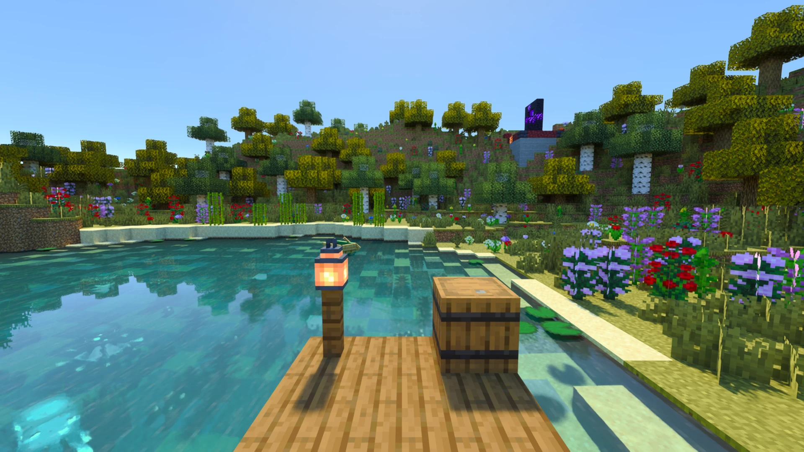
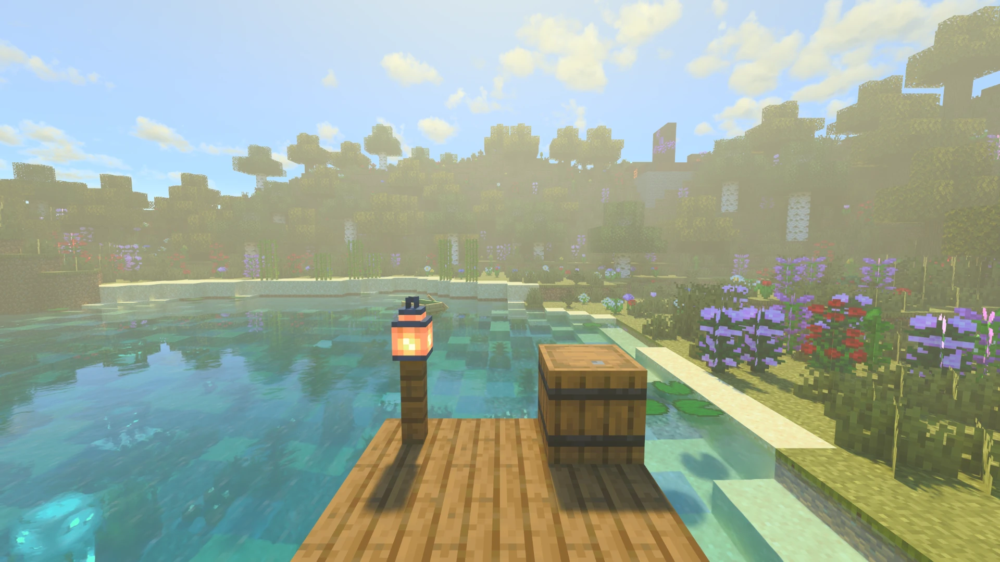

[← Back to index](README.md)

# Quality and performance

How to get more FPS, and what each quality level sets. For every control of the Performance section one by one, see
[settings/performance.md](settings/performance.md).

## Start with the Quality level

The **Quality** selector, at the top of the [Quality section](settings/quality-and-upscaling.md), sets the controls
that cost the most at once, in combinations already tested:

| Level | Upscaler mode | Volumetric Fog | Clouds | Render Distance | Light Bounces | Carved Surfaces | Fog Quality |
|---|---|---|---|---|---|---|---|
| **Low** | Ultra Performance | Off | Off | 8 chunks | 2 | Off | 8 samples |
| **Medium** | Performance | Off | Vanilla | 12 chunks | 2 | Off | 8 samples |
| **High** | Balanced | On | Vanilla | 16 chunks | 3 | On | 16 samples |
| **Ultra** | Quality | On | Volumetric | 24 chunks | 4 | On | 24 samples |

Block Light Sampling stays on at every level. The mode applies to whichever upscaler you use (DLSS Mode, or
Upscaling Mode with FSR and XeSS). Changing one of these controls by hand shows **Custom**; a fresh install may show
Custom too, because the defaults match no level exactly.

| Low | Ultra |
|---|---|
|  |  |

## What costs the most

Measured on one scene, from DLSS Ultra Performance (~150 fps) or Balanced (~80 fps):

| Control | Cost | Notes |
|---|---|---|
| **Upscaler mode** | Performance −45%, Quality −65% (from Ultra Performance) | The biggest lever. Touch it first. |
| **Light Bounces** (default 4) | 4 → 2 gains ~55% | Little visible change. **Cache Deep Bounces** (on) and **One Bounce + Cache** save more. |
| **Render distance** | 24 chunks costs ~30% more than 16 | |
| **Volumetric Fog** | ~10% | 32 samples cost ~30% more than 16. |
| **Block Light Sampling** | ~20% | Off is much noisier at night and in caves. Usually worth keeping. |
| **Carved Surfaces, Clouds** | A few % each | Last to touch. |

Held Item Light and First Person Shadow cost nothing measurable.

### Minecraft's own video settings

With ray tracing on, these change neither the picture nor the frame time (measured 2026-11-12, both on and off, GPU
time per pass the same within noise). Leave them as you like for when ray tracing is off:

- **Smooth Lighting**: the traced light replaces it.
- **Entity Shadows**: the round shadow under mobs is not drawn; they cast their own shadows.
- **Mipmap Levels**, **Texture Filtering** and its anisotropy: the tracer picks each texture's detail by its own
  measure of the pixel's size on the surface.
- **Improved Transparency**: see-through blocks are traced in order anyway.
- **Chunk Fade-In** and **Chunk Update priority**: the traced world builds its chunks with its own threads (see
  Chunk Threads).
- **Cutout Leaves**: leaves stay see-through either way.

**Biome Blend** still applies: the grass, foliage and water colours come from Minecraft's own.

## Specific problems

**Out of video memory:** lower **Chunk Batches** (Performance section) and the render distance. Distant Horizons'
own distance uses VRAM too.

**Stutter when flying or teleporting:** raise **Chunk Threads** if the CPU has room, but not past half your logical
cores ([why](settings/performance.md#why-the-chunk-threads-maximum-is-half-your-cores)). If the stutter comes when
chunks are built, lower **Chunk Batch Size**.

**The first world after an update is slow to open:** shaders compile again after an update or a new driver, from a
few seconds to a minute. Radiante starts this on the title screen with a progress popup, and remembers it in
`radiante/warmup.properties`. Deleting `radiante/cache` makes it run again.

## Frame generation

With 60+ real FPS on a 144 Hz or faster monitor, [frame generation](upscalers.md#frame-generation) adds smoothness
without lowering quality, at some latency that Reflex offsets. FSR works on any GPU (2x); DLSS on NVIDIA (up to 4x on
RTX 50).

## Reference numbers

A documented preset for mid-range GPUs (an RTX 3060 or RX 6700 at 60 fps, 12 chunks) is tracked in
[issue #21](https://github.com/Gabrieli2806/Radiante/issues/21). Share your own numbers on
[Discord](https://discord.gg/DhBbAzugZ9).
