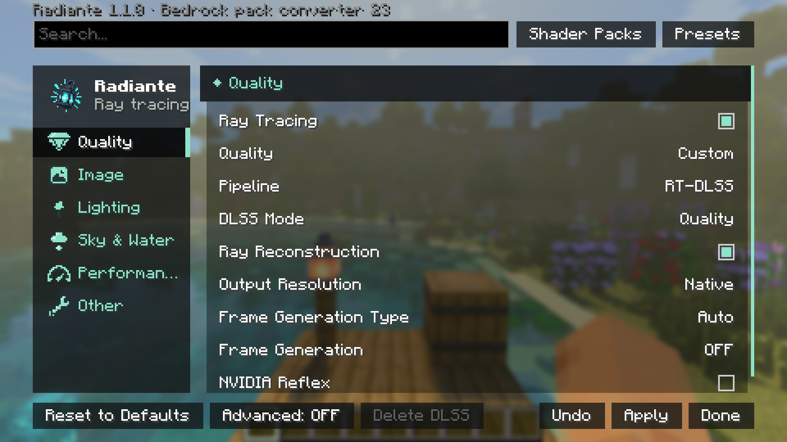

[← Back to index](README.md)

# Settings

Open them with `F6` in a world, or from Options → Video Settings → Radiante (title screen included).

## How the screen works

- **Sections** are on the left; the panel on the right describes the setting under the mouse.
- **Apply** applies your changes and keeps the screen open; **Done** applies and closes; **Undo** drops what changed
  since the last Apply. Changes compile in the background with a progress popup at the top right.
- **Search** finds a setting in any section by name.
- **Advanced** (bottom) shows the fine-tuning controls of each section in folding groups, and adds the Debug section.
- **Reset to Defaults** (bottom left) returns everything to a fresh install. Hold **Ctrl** to turn it into **Rebuild
  Shaders**, for when the picture looks wrong after a change.
- **HDR Output** and installing an upscaler apply after a restart. Leaving the screen lists what is pending.

The panel also shows each setting's **performance impact** (None, Low, Medium, High or Varies), why a grey row does
nothing right now, and which other settings it replaces.

## Sections

| Section | What is in it |
|---|---|
| [Quality](settings/quality-and-upscaling.md) | Ray tracing on/off, quality level, pipeline and upscaler, resolution, frame generation, Reflex |
| [Image](settings/image.md) | Picture style, tone mapping, exposure, sharpness, HDR, motion blur, depth of field |
| [Lighting](settings/lighting.md) | Brightness, bounced and sky light, block light sampling, ReSTIR, held light |
| [Sky & Water](settings/sky-fog-water.md) | Atmosphere, clouds, stars, sun, rain, glass, biome ambiance, fog, water |
| [Performance](settings/performance.md) | Light bounces, reflections, cache, parallax, chunk building |
| [Other and Debug](settings/other-and-debug.md) | Block outline, other mods' overlays; debug views and logs (Advanced) |
| *A shader pack's name* | That pack's own settings, when one other than Radiante PT is in use |
| Addons | Options of mods built on Radiante ([API](api.md#radianteaddons)) |

A setting only shows when the pipeline, GPU or shader pack supports it: DLSS Mode only with RT-DLSS, Reflex only on
NVIDIA, frame generation not with HDR. If something here is missing from your screen, that is why.

## Presets

**Presets**, next to the search box, keeps your looks: save the current one, switch with a click, copy one as a code
to share, or import a code. A preset holds lighting, sky, fog, water, tone and camera effects; the upscaler, frame
generation and HDR stay as they are.

<!-- Screenshot pending: the Presets screen -->

## Shader packs

**Shader Packs**, beside Presets, chooses the path tracer:

- **Radiante PT** (default): the Bedrock RTX look.
- **Pixelated Lighting** (built in): shadows and reflections in the texture's pixels.
- Packs you add to `radiante/shaderpacks/` (**Open Folder**), as a `.zip` or a folder. This is Radiante's own
  folder, not the `shaderpacks/` folder Iris and OptiFine use.

Select a pack and press **Use**. If it fails to load or compile, Radiante goes back to Radiante PT and shows the
error (**Copy Error** for the pack's author). Each pack keeps its own settings, and a pack other than Radiante PT
adds a section named after it, with its presets and settings.

<!-- Screenshot pending: the Shader Packs screen and a pack's settings page -->

Making your own: [Making a shader pack](shader-packs.md).

## Keyboard and controller

| Keyboard | Controller (Controlify) | Does |
|---|---|---|
| Up / Down | D-pad, left stick | Move through settings and buttons |
| Left / Right (Shift: ×10) | Right stick left / right (×10) | Move a slider, step a list |
| Enter / Space | A | Toggle, press, fold a group |
| Tab / Shift+Tab | RB / LB | Next / previous section |
| | B | Leave, like **Done** |
| | X / Y | Apply / Undo |
