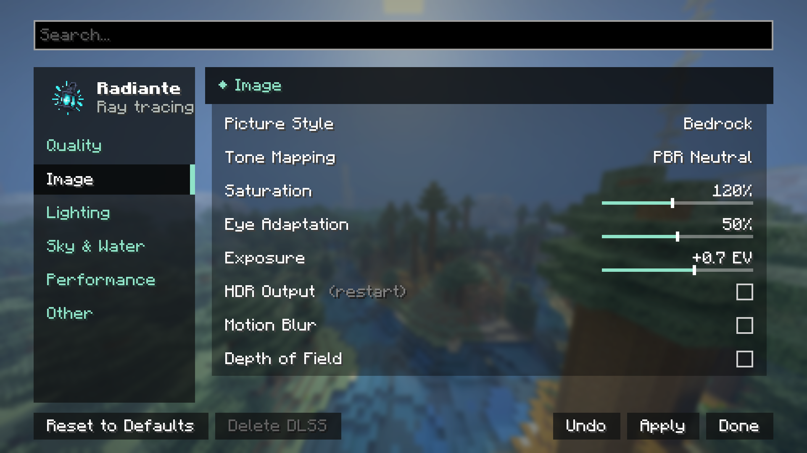

[← Settings](../settings.md) · [Index](../README.md)

# Image

| Control | Range / Values | Default | What it does |
|---|---|---|---|
| **Renderer Profile** | Bedrock RTX (Enhanced) · Realistic · Custom | Bedrock RTX (Enhanced) | Radiante: the look Radiante had before 1.0. Bedrock RTX (the default): bloom, a Bedrock-style tone mapper, exact sRGB colours, Bedrock's glass and water reflections, sunlight filtered by glass, denser water that fogs out the distance under water, and Bedrock's caustics. **Realistic** is Bedrock RTX (Enhanced) with everything that makes a picture look like plastic set the other way: less ambient and bounced fill (shadows keep their depth), slightly more contrast, calmer colour (92 % saturation), almost no bloom, light shafts and sun glow at half strength, finer irregular water waves with a fainter water pattern, only polished metal as a clean mirror, and an eye that adapts more slowly. It is darker than Enhanced on purpose. Changing one of its settings turns it into Custom. Applied last: it overrides the matching settings changed in the same visit. More in [bedrock-rtx.md](../bedrock-rtx.md). |
| **Picture Style** | Natural · Bedrock · Vivid · Custom | Natural | Sets Saturation, Bounced Light and Sky Light at once. Full detail in [styles-and-quality.md#picture-styles](../styles-and-quality.md#picture-styles). |
| **Tone Mapping** | PBR Neutral · ACES · Reinhard | PBR Neutral | How bright light is fitted to what the screen can show. PBR Neutral keeps colours true; ACES is more filmic with more contrast; Reinhard is soft and flat. |
| **Saturation** | 50% – 200% | 120% | How colourful the image is. 100% is unchanged from the shader pack's own. |
| **Texture Contrast** | 46% – 109% | 100% | How deep and contrasted block and entity colours look under the light. 100% matches Bedrock RTX; lower gives the paler, flatter look of earlier versions. |
| **Eye Adaptation** | 0% – 100% | 50% | How far the exposure adapts to what you look at. Lower keeps dark rooms dark and daylight bright, as in Bedrock; 100% always evens the image out. |
| **Eye Adaptation Speed** | 5% – 250% | 100% | How quickly the exposure follows when you walk from the dark into the light or back. Lower lets you see your eyes adjust for a moment, as in Bedrock; 100% is close to instant. |
| **Exposure** | -3.0 EV – +3.0 EV | +0.7 EV | Overall brightness of the image, in photographic stops. |
| **Low-Light Boost** | 25% – 400% | 100% | How much the exposure may brighten a dark scene. Higher lets you see more in caves and at night; lower keeps the dark dark. |
| **Daytime Exposure** | 10% – 150% | 48% | How bright the picture is kept by day, against what the light meter alone would make it. Lower is darker. |
| **Night-time Exposure** | 10% – 150% | 65% | The same at night. |
| **Daytime Low-Light Limit** | 50% – 3200% | 250% | How far the exposure may open by day in a dark place. Low keeps closed rooms dark; high brightens rooms lit only through a window. |
| **FSR Sharpness** | 0% – 100% | 70% | How much FSR sharpens the upscaled image. Higher is crisper but can show halos on edges. FSR pipelines only. |
| **Motion Blur** | On/Off | Off | Smears what moves across the screen along its motion, as a camera does. Changing it rebuilds the shaders (a brief hitch when applying). |
| **Depth of Field** | On/Off | Off | Keeps what you look at sharp and blurs what is much nearer or farther, focusing on the centre of the screen. Also rebuilds the shaders when changed. |
| **Motion Blur Strength** | 10% – 220% | 100% | How long the smear of Motion Blur is. |
| **Depth of Field Blur** | 25% – 400% | 100% | How strongly what is out of focus blurs. |
| **Depth of Field Focus Range** | 10% – 400% | 100% | How much around what you look at stays sharp. Lower blurs sooner, for a close-up look. |
| **Auto Focus** | On / Off | On | Depth of Field focuses on whatever is at the centre of the screen. Off keeps the focus at Focus Distance, for screenshots. |
| **Focus Distance** | 1 – 256 blocks | 12 | How far away the image is sharp when Auto Focus is off. |

The four Depth of Field and Motion Blur sliders rebuild the shaders when changed, like the two
switches. With the Bedrock RTX profile the tone mapper is Bedrock-style (a curve built from the
picture's histogram) and the exposure is metered on the light reaching the surfaces in view, so
Tone Mapping and the exposure sliders behave a little differently there.

## HDR

The HDR section is in this same category, below the controls above. It is covered in full, with
screenshots and display considerations, in [hdr.md](../hdr.md) — quick summary:

| Control | Range | Default |
|---|---|---|
| HDR Output | On/Off | Off |
| HDR Peak Brightness | 400 – 4000 nits | 1000 nits |
| HDR Paper White | 80 – 400 nits | 200 nits |
| HDR Debug View | On/Off | Off (not saved) |

Turning HDR Output on or off needs a game restart; the two brightness sliders apply instantly.
