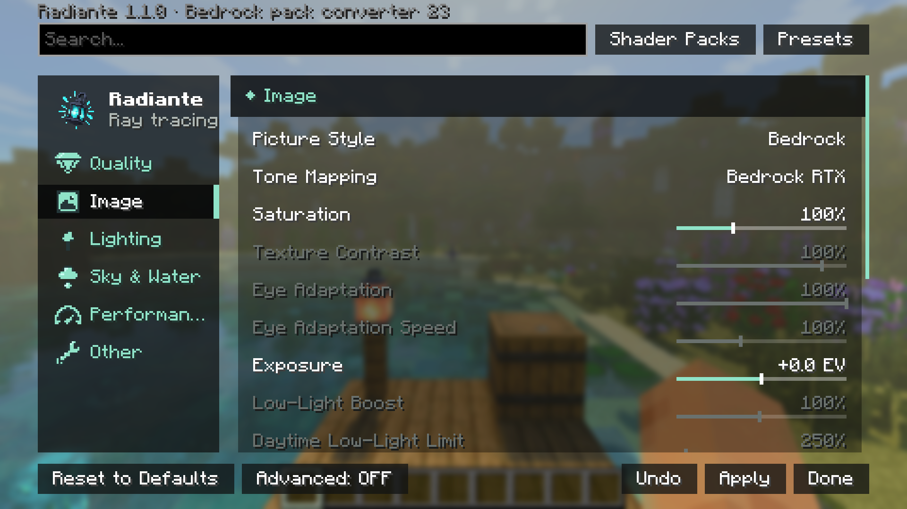
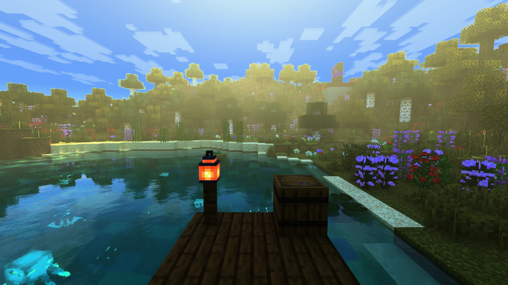
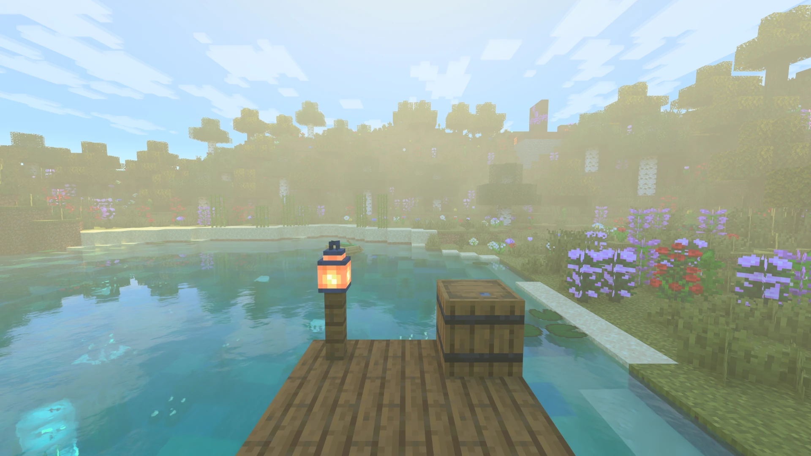
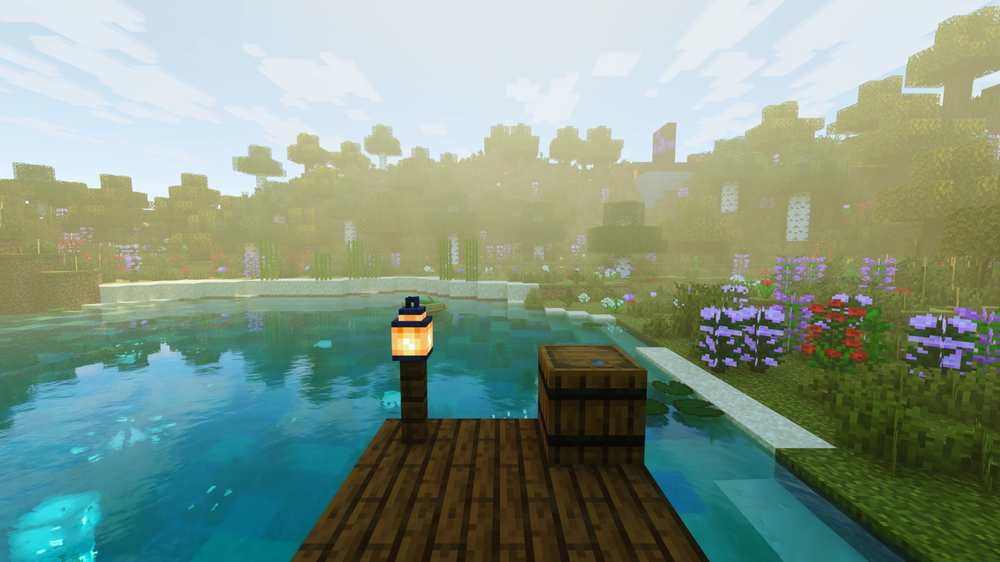

[← Settings](../settings.md) · [Index](../README.md)

# Image

Defaults are radiante-pt's, the Bedrock RTX look ([bedrock-rtx.md](../bedrock-rtx.md)).

| Control | Range / Values | Default | What it does |
|---|---|---|---|
| **Picture Style** | Natural · Bedrock · Vivid · Custom | Bedrock | Sets the tone curve and Saturation at once. Bedrock is the default look. See [Picture styles](#picture-styles) below. |
| **Tone Mapping** | Bedrock RTX · PBR Neutral · ACES · Reinhard | Bedrock RTX | How bright light is fitted to what the screen can show. Bedrock RTX is Bedrock's own curve, built from the picture's histogram; PBR Neutral keeps colours true; ACES is more filmic with more contrast; Reinhard is soft and flat. |
| **Saturation** | 50% – 200% | 100% | How colourful the image is. |
| **Texture Contrast** | 46% – 109% | 100% | How deep and contrasted block and entity colours look under the light. 100% matches Bedrock RTX; lower gives the paler, flatter look of earlier versions. Grey while Exact sRGB Textures (Advanced) is on, the default. |
| **Eye Adaptation** | 0% – 100% | 100% | How far the exposure adapts to what you look at. Lower keeps dark rooms dark and daylight bright; 100% always evens the image out. Grey with Bedrock RTX's metering (see [below](#exposure-rows-that-are-grey)). |
| **Eye Adaptation Speed** | 5% – 250% | 100% | How quickly the exposure follows when you walk from the dark into the light or back. Lower lets you see your eyes adjust for a moment; 100% is close to instant. Grey with Bedrock RTX's metering. |
| **Exposure** | -3.0 EV – +3.0 EV | +0.0 EV | Overall brightness of the image, in photographic stops. |
| **Low-Light Boost** | 1% – 200% | 100% | How much the exposure may brighten a dark scene. Higher lets you see more in caves and at night; lower keeps the dark dark. 100% is Bedrock RTX's limit. Grey with Bedrock RTX's metering. |
| **Daytime Low-Light Limit** | 50% – 3200% | 250% | How far the exposure may open by day in a dark place. Low keeps closed rooms dark; high brightens rooms lit only through a window. Grey unless the metering mode is Incident Light (Bedrock). |
| **FSR Sharpness** | 0% – 100% | 70% | How much FSR sharpens the upscaled image. Higher is crisper but can show halos on edges. RT-FSR only. |
| **HDR Output** | On / Off | Off | HDR on an HDR display; the brightness controls below it show when it is on. See [HDR](../hdr.md). |
| **Motion Blur** | On / Off | Off | Smears what moves across the screen along its motion, as a camera does. Changing it rebuilds the shaders (a brief hitch when applying). |
| **Depth of Field** | On / Off | Off | Keeps what you look at sharp and blurs what is much nearer or farther, focusing on the centre of the screen. Also rebuilds the shaders when changed. |
| **Motion Blur Strength** | 10% – 220% | 100% | How long the smear of Motion Blur is. Needs Motion Blur. |
| **Depth of Field Blur** | 25% – 400% | 100% | How strongly what is out of focus blurs. Needs Depth of Field. |
| **Depth of Field Focus Range** | 10% – 400% | 100% | How much around what you look at stays sharp. Lower blurs sooner, for a close-up look. |
| **Auto Focus** | On / Off | On | Depth of Field focuses on whatever is at the centre of the screen. Off keeps the focus at Focus Distance, for screenshots. |
| **Focus Distance** | 1 – 256 blocks | 12 | How far away the image is sharp when Auto Focus is off. |

With the Bedrock RTX tone curve (the default) the tone mapper is Bedrock-style (a curve built from the picture's
histogram) and the exposure is metered on the light reaching the surfaces in view, so the exposure
sliders behave a little differently than with the PBR Neutral, ACES or Reinhard curves.

## Exposure rows that are grey

Some rows are grey at the defaults, and the panel on the right says why:

- **Eye Adaptation**, **Eye Adaptation Speed** and **Low-Light Boost** are grey while **Exposure Metering Mode**
  (Advanced) is **Incident light, Bedrock RTX**, the default: Bedrock RTX's metering has its own limits and speed.
- **Daytime Low-Light Limit** is grey unless the metering mode is **Incident Light (Bedrock)**.
- **Texture Contrast** is grey while **Exact sRGB Textures** (Advanced) is on, the default.

## Picture styles

**Picture Style** sets Tone Mapping and Saturation at once, and nothing else. Changing one of them by hand shows
**Custom**.

| Style | Tone Mapping | Saturation | Look |
|---|---|---|---|
| **Natural** | PBR Neutral | 100% | Colours kept true |
| **Bedrock** (default) | Bedrock RTX | 100% | Bedrock RTX's own curve |
| **Vivid** | ACES | 130% | More contrast and colour |

| Natural | Bedrock | Vivid |
|---|---|---|
|  |  |  |

Picture Style and **Atmosphere** (in [Sky & Water](sky-fog-water.md)) are independent: Atmosphere picks where the
sky's colours come from, Picture Style how the final picture is processed.

HDR Output and its brightness controls are explained in [HDR](../hdr.md).
