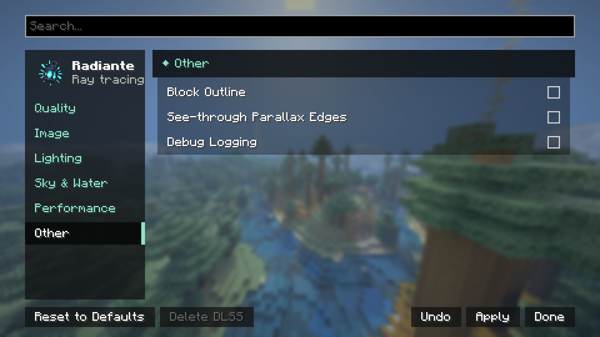

[← Settings](../settings.md) · [Index](../README.md)

# Other

| Control | Values | Default | What it does |
|---|---|---|---|
| **Block Outline** | On/Off | Off | The outline around the block under the crosshair. |
| **Other Mods' Overlays** | On / Off | On | Lets other mods draw into the traced world: Litematica schematics and selection boxes, MiniHUD shapes, waypoint beams, guides and markers. They are drawn Minecraft's way on top of the traced picture, hidden behind the world where they should be. Turn it off if a mod draws something wrong over the world. |
| **Text Display Backgrounds** | On / Off | On | Draws the translucent plate behind text displays (leaderboards, holograms, server signs) as Minecraft does, so the text is easier to read. Off shows only the letters. |
| **See-through Parallax Edges** | On/Off | Off | With resource packs that carve their textures (parallax), the carved part at the outer edges of a block becomes see-through, as if it were really cut away. Off, those edges show the border's colour instead of transparency. |

None of these affects performance in any measurable way; they are comfort settings, not visual
quality or speed ones. Debug Logging is now in the [Debug](debug.md) section. The top left of the screen shows the Radiante version and the
Bedrock pack converter's, for bug reports.
