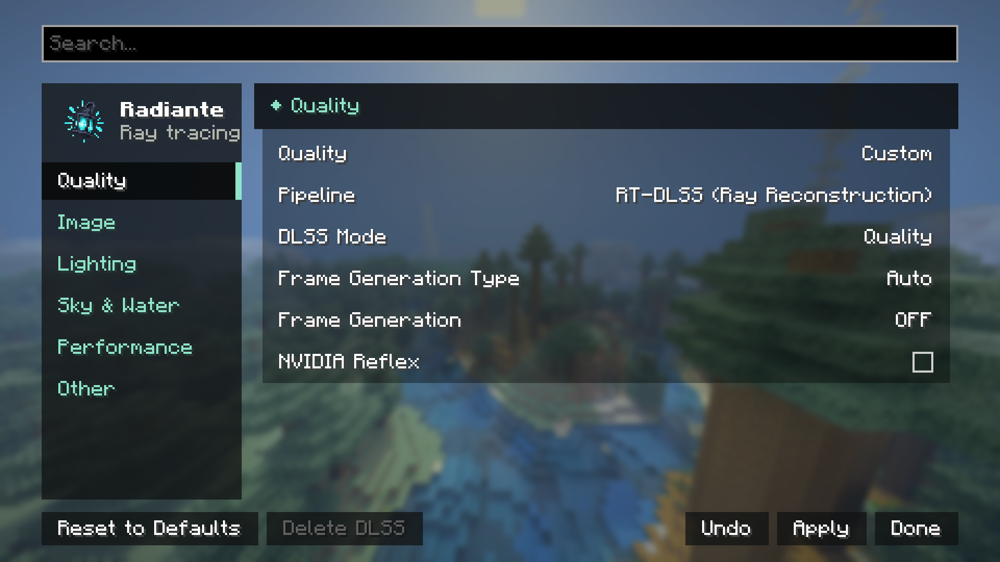

[← Settings](../settings.md) · [Index](../README.md)

# Quality & Upscaling

| Control | Values | Default | What it does |
|---|---|---|---|
| **Ray Tracing** | On / Off | On | Switches between Radiante's ray traced renderer and Minecraft's own, at once, like the Toggle Ray Tracing key (unbound by default; set it in Controls). The world is rebuilt for the renderer that takes over. |
| **Quality** | Low · Medium · High · Ultra · Custom | — | Sets the costliest settings at once. See [Quality and Reset to Defaults](../settings.md#quality-and-reset-to-defaults). |
| **Pipeline** | RT-DLSS · RT-NRD · RT-NRD-FSR · RT-NRD-XeSS. Those not installed show as `(Install)` or `(Restart required)` | RT-DLSS if DLSS is already installed; otherwise RT-NRD-FSR | Denoiser and upscaler. See below and [Upscalers](../upscalers.md). |
| **DLSS Mode** | Quality · Balanced · Performance · Ultra Performance | Ultra Performance | RT-DLSS only. Internal resolution before upscaling. |
| **Upscaling Mode** | FSR: Ultra Performance · Performance · Balanced · Quality · Native AA. XeSS adds Ultra Quality and Ultra Quality Plus. Custom, for a resolution set by hand | Quality | The same as DLSS Mode, for FSR and XeSS. The Quality level sets it too. |
| **Render Resolution** | up to 100% | — | Only in the **Custom** upscaling mode: the share of the screen resolution the world is traced at before the upscaler scales it up, set by hand. Lower is faster and softer; below 33% no upscaler is designed to work. Picking a Quality level or another mode leaves it. |
| **Frame Generation Type** | Auto · DLSS · FSR | Auto | Auto picks DLSS when the GPU supports it, FSR otherwise. FSR works with any upscaler but only doubles. |
| **Frame Generation** | Off · 2x … 4x | Off | Extra frames between the rendered ones. Hidden with HDR Output. See [frame-generation-reflex.md](../frame-generation-reflex.md). |
| **NVIDIA Reflex** | On / Off | Off | Low latency. NVIDIA with `VK_NV_low_latency2` only; hidden on other GPUs. No restart. |

## The pipelines

- **RT-DLSS (Ray Reconstruction)**: DLSS denoises and upscales at once. The least noisy. NVIDIA
  only, downloaded in game.
- **RT-NRD-FSR**: NRD (RELAX) denoiser and FSR 3. Any GPU, built in. The default when DLSS is not
  installed.
- **RT-NRD-XeSS**: NRD and XeSS. Windows, downloaded in game. Recommended on Intel Arc.
- **RT-NRD**: NRD with no upscaler, at native resolution. Any GPU; the most expensive.

## Picking a pipeline installs nothing by itself

Picking `RT-DLSS (Install)` turns the bottom bar into **Install DLSS (115 MB)**. Installing or
deleting is done outside a world and ends in a restart. After installing, pick RT-DLSS: the
pipeline does not switch on its own. See [Upscalers](../upscalers.md).
