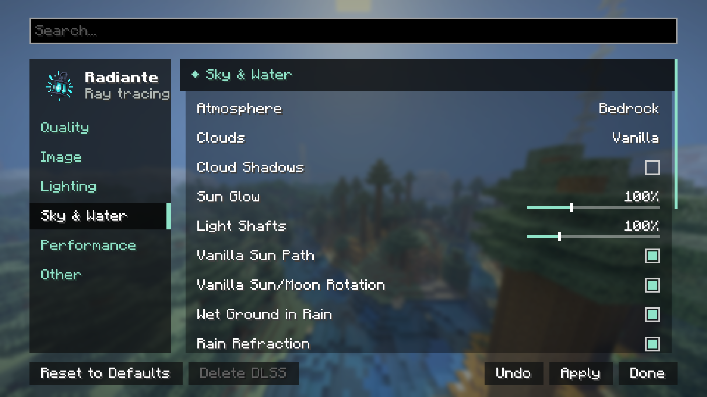
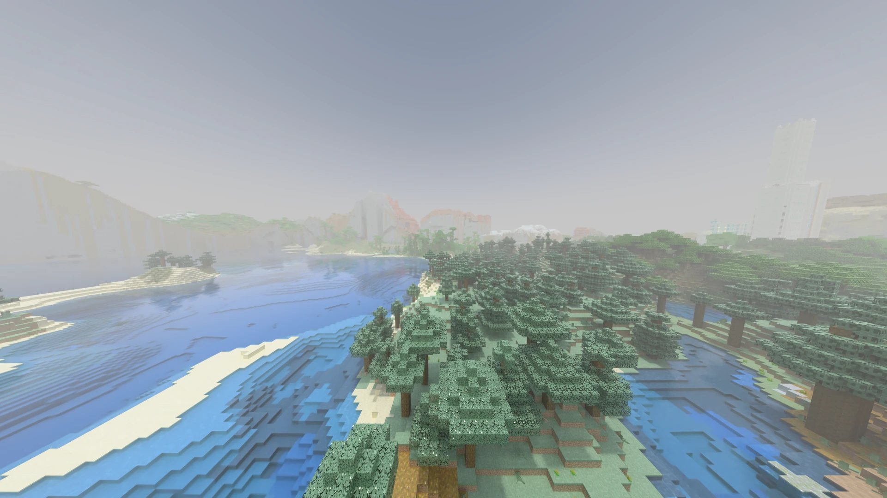
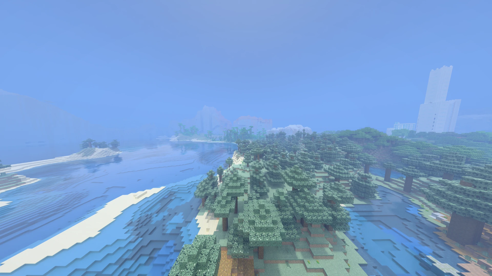

[← Settings](../settings.md) · [Index](../README.md)

# Sky & Water

**Volumetric fog.** Fog off and on at noon.

| Off | On |
|---|---|
|  |  |

Defaults are radiante-pt's, the Bedrock RTX look ([bedrock-rtx.md](../bedrock-rtx.md)).

| Control | Range / Values | Default | What it does |
|---|---|---|---|
| **Atmosphere** | Java · Bedrock | Bedrock | Bedrock: Bedrock RTX's sky and sunlight colours, read from a Bedrock install on this PC (or from `radiante/bedrock/sky.png` and `look_up_tables.png`). Java: Radiante's own sky. Without those files the option is grey, shows Java (Bedrock not available) and the Java sky is used. Full detail in [bedrock-rtx.md](../bedrock-rtx.md). |
| **Clouds** | Off · Vanilla · Volumetric | Vanilla | How clouds are drawn. Volumetric are real 3D clouds that can cast shadows and cost the most GPU time; Vanilla is cheaper (the usual flat cloud mesh, but traced and lit); Off is fastest. |
| **Cloud Height** | -96 – +320 blocks | 0 | Raises or lowers the Vanilla clouds above their usual height. Vanilla clouds only. |
| **Cloud Shadows** | On / Off | Off | Volumetric clouds cast soft shadows on the ground. Volumetric clouds only, like the three below. |
| **Cloud Coverage** | 0% – 100% | 50% | How much of the sky volumetric clouds cover. |
| **Cloud Density** | 0% – 400% | 100% | How thick volumetric clouds are. |
| **Cloud Quality** | 8 – 256 | 64 | Steps taken through volumetric clouds per ray. Higher is smoother and costs frame rate. |
| **Stars** | 100 – 20000 | 3000 | How many stars the night sky has. |
| **Stars at Altitude** | 0% – 400% | 100% | How much clearer the stars get the higher you are: at 100% they are twice as bright from a mountain top (around Y 190) as from sea level. 0% keeps them the same everywhere. With Biome Ambiance on, the biome's air counts too: sharper over deserts, peaks and the open sea, dimmer in a swamp's or a jungle's haze. |
| **Sun Glow** | 0% – 300% | 100% | The halo around the sun. |
| **Light Shafts** | 0% – 400% | 100% | Beams of light through windows, skylights and leaves, within about 48 blocks of you. Needs Volumetric Fog. |
| **Aerial Perspective** | 0% – 400% | 100% | The air's own haze over the distance: far terrain, Distant Horizons' included, fades towards the sky behind it, about an eighth of the way at 16 chunks and two fifths at 64 at sea level on a clear day. Thicker in rain, thunder and humid biomes (jungle, swamp), thinner over deserts and from a mountain top, none in caves. Works with Volumetric Fog on or off and with Biome Ambiance (whose haze it does not stack on). 0% turns it off; no effect on performance. |
| **Aerial Perspective Start** | 0 – 1024 blocks | 128 | How far from you the distance haze begins. Nothing nearer is hazed; past it the haze comes in over half that distance again (at least 32 blocks). Raise it to keep more of the land around you crisp. |
| **Sun Path** | Vanilla · Tilted · Custom | Vanilla | Vanilla: sun and moon cross straight overhead from east to west. Tilted: the path leans ten degrees south, so noon shadows are not straight down. Custom shows when the [Sun & Moon Path](#sun--moon-path-advanced) settings hold anything else. |
| **Vanilla Sun/Moon Rotation** | On / Off | On | Keeps the sun and moon squares lined up with their path as in vanilla, instead of turning as they cross the sky. |
| **Wet Ground in Rain** | On / Off | On | Surfaces under open sky darken and shine while it rains, and dry slowly after. |
| **Puddles** | 0% – 100% | 50% | How much standing water rain leaves on the flat tops of open full blocks, with Wet Ground in Rain on: gathering in patches that merge into one film with rain rings over a couple of minutes of rain, then drying up in patches over about three minutes. Full from 50%; 0% leaves only wet ground. |
| **Lightning Flash** | 0% – 200% | 100% | How brightly a lightning flash lights the world in a thunderstorm, from the bolt's direction and with shadows. 0% leaves only the bolt's own glow. Off with the game's *Hide Lightning Flashes* accessibility option. |
| **Wind** | On / Off | Off | Leaves, grass, flowers, crops, saplings, sugar cane, vines and lily pads sway in the wind within about 48 blocks of you, harder in rain and thunder; seagrass and kelp sway slowly with the current. The geometry itself moves, so shadows, reflections and light through the leaves move with it. Switching it reloads the world's geometry. In a dense forest it costs about 0.6 ms a frame on an RTX 5070; off, nothing. |
| **Wind Strength** | 0% – 200% | 100% | How far the wind moves leaves and plants while Wind is on. 0% holds them still. |
| **Seamless Glass** | On / Off | Off | Removes the frame around each glass block and pane: a glass wall reads as one sheet. Off by default, as Bedrock shows each block in its frame. |
| **Seamless Glass Scope** | Glass blocks and panes · Glass blocks only · Panes only | Glass blocks and panes | Which glass Seamless Glass joins. Needs Seamless Glass. |
| **Biome Ambiance** | On / Off | Off | Each biome's own air and water, kept subtle: warm dust over deserts, a green murk over swamps, a cold bright mist over snow, red, teal and ash in the Nether, violet in the End; under water, clear and bright by a beach, dark and close in the deep ocean. Fades from one biome to the next, stays out of overworld caves, and works with or without Volumetric Fog. More under [Biome Ambiance](#biome-ambiance) below. |
| **Biome Ambiance Strength** | 0% – 400% | 100% | How thick each biome's haze is. 100% is the tuned, subtle look; no effect on performance. Needs Biome Ambiance. |
| **Volumetric Fog** | On / Off | On | Ray marches the air: sunlight and moonlight scatter in it, and trees and terrain cast light shafts through it. Costs noticeably more GPU time than the plain haze. By default it is Bedrock's own fog volume. |
| **Fog Style** | Froxel · Radiante | Froxel | Froxel: a 3D grid of light fixed to the world around the camera, lit cell by cell and kept across frames, so the fog holds still while you look around; sharper shafts, block lights glow in the fog, and it costs less. Radiante: each pixel marches the air itself; follows every surface exactly but costs more. Hidden while Bedrock Volumetric Fog (Advanced, on by default) fogs the air with its own volume. |
| **Volumetric Fog Strength** | 0% – 400% | 100% | How thick the air that shows sunbeams and light shafts is. No effect on performance — only the sample count (in [Performance](performance.md)) does. |
| **Fog Distance** | 48 – 192 blocks | 128 | How far volumetric fog and light shafts reach. |
| **Water Waves** | 0% – 400% | 100% | How rough the water surface is. 0% is a flat, mirror-like surface. |
| **Water Murkiness** | 0% – 400% | 100% | How quickly the view fades out underwater. Lower is clearer. 100% is Bedrock's full extinction. |
| **Underwater Light Rays** | 0% – 400% | 100% | Shafts of sunlight through the water surface while underwater. |

With Bedrock Volumetric Fog on (under Advanced, the default) the air is fogged
by Bedrock's own volume, 50 blocks deep: it shows the biome's fog (with Biome Ambiance on) and the light shafts
(Light Shafts and Volumetric Fog Strength set how strong). It has no use for Fog Distance or Volumetric Fog
Quality: those rows are grey and say so. The haze over the distance beyond it is Aerial Perspective.

## Sun & Moon Path (advanced)

With **Advanced** on, the Sun & Moon Path group sets the sky's path by hand. Everything that uses the sun or the moon
follows it at once, without a rebuild: the sky and its glow, shadows, clouds, fog and light shafts, water and the
Bedrock RTX lighting.

| Control | Range | Default | What it does |
|---|---|---|---|
| **Sun Path Tilt** | -45° – 45° | 0° | How far the sun's path leans from straight overhead: positive south, negative north. The sun still rises and sets at the same times. Tilted is 10°. |
| **Sun Path Rotation** | -180° – 180° | 0° | Turns the path around the sky; positive turns it clockwise seen from above, moving sunrise from the east towards the south. |
| **Sun Rotation** | -180° – 180° | 0° | Turns the sun's square around its own centre. Only how it looks. |
| **Moon Follows Sun** | On/Off | On | The moon crosses on the sun's path, opposite the sun, as in vanilla. Off, it takes the two settings below; it still rises as the sun sets. |
| **Moon Path Tilt** | -45° – 45° | 0° | The moon's own lean, as Sun Path Tilt. Only with Moon Follows Sun off. |
| **Moon Path Rotation** | -180° – 180° | 0° | The moon's own turn, as Sun Path Rotation. Only with Moon Follows Sun off. |
| **Moon Rotation** | -180° – 180° | 0° | Turns the moon's square around its own centre. Only how it looks. |

With ray tracing off, Minecraft draws its own sky, which keeps vanilla's path.

## Biome Ambiance

Every biome has an air of its own and every kind of water a look of its own. It is meant to be
felt more than seen: a plain loses under a tenth of the view at ten chunks, and the thickest air
(a pale garden) about a third. The haze belongs to the distance and the horizon; the sky above it
is left alone.

- **Air.** A tint, a thickness and how it takes each colour: desert and badlands dust turns the
  distance warm, snow and ice give a cold bright mist, forests a soft green-grey, swamps and
  mangroves a low murk that stays near the water, peaks nearly clear air. It thickens in rain,
  thins out with height and stays out of caves.
- **Water.** Seen from under it: clear and bright by a beach and in warm oceans, plain in the
  ocean, dark and close in the deep oceans (darker still in the cold ones), murky in swamps. The
  deeper the camera, the darker the water around it, and water under a roof or deep in a cave is
  lit less than water under the open sky.
- **Crossing a border.** The biomes within twenty blocks of the camera are averaged and the result
  eased in over a couple of seconds, so one biome fades into the next and never switches.
- **Bedrock RTX packs.** A converted `.mcpack` brings its own fog and water for each biome. Their
  colours, and which biomes are thick or clear, are taken from the pack; how strong they are is
  brought into the same subtle range.
- **Biomes from mods and data packs.** Nothing to set up: the look is worked out from the biome's
  tags (swamp, desert, snowy, spooky, magical and so on, including the loaders' shared `c:` tags),
  its climate, and its own fog and water colours.

## Nether and End

Biome Ambiance also applies in the Nether and the End, where there is no sky to light a haze:
there it has a colour of its own (red in the wastes, crimson, teal, ash-blue in the soul sand
valley, grey in the basalt deltas, violet in the End) and is kept thin, so it never takes more
than half of what is behind it. Volumetric Fog, on the other
hand, only applies in the Overworld; the Nether and End always use the plain haze, whether it is
turned on or not.
