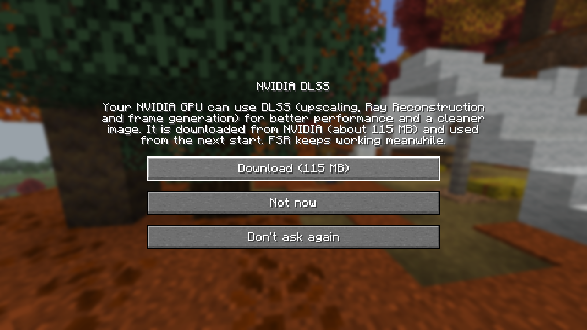
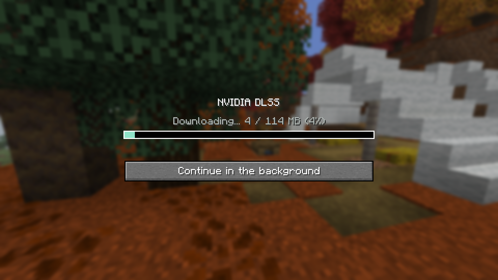
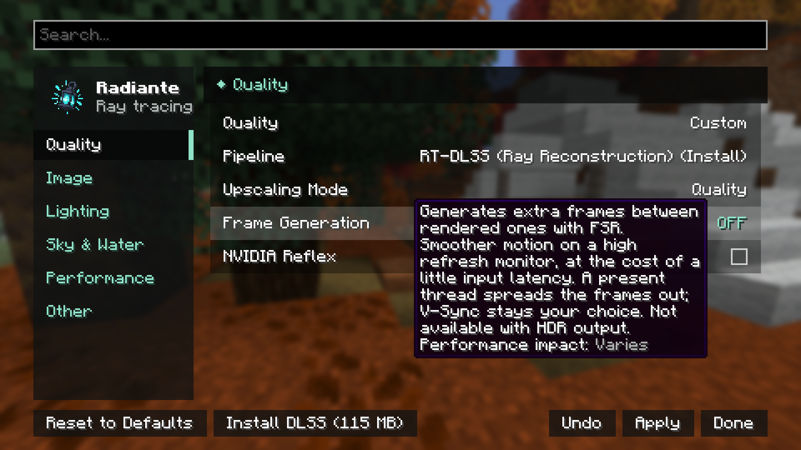
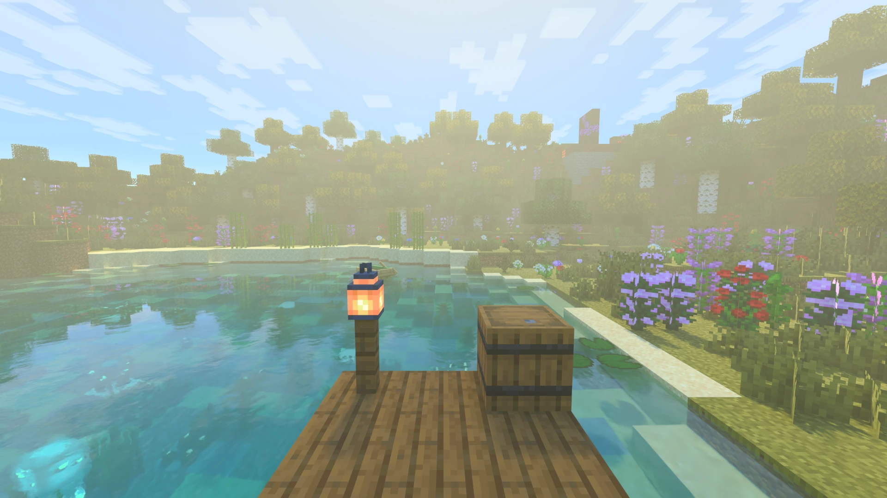
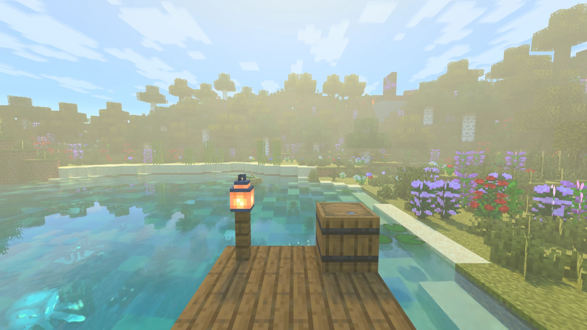
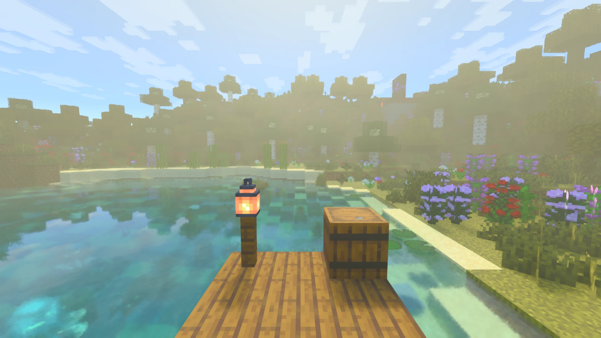
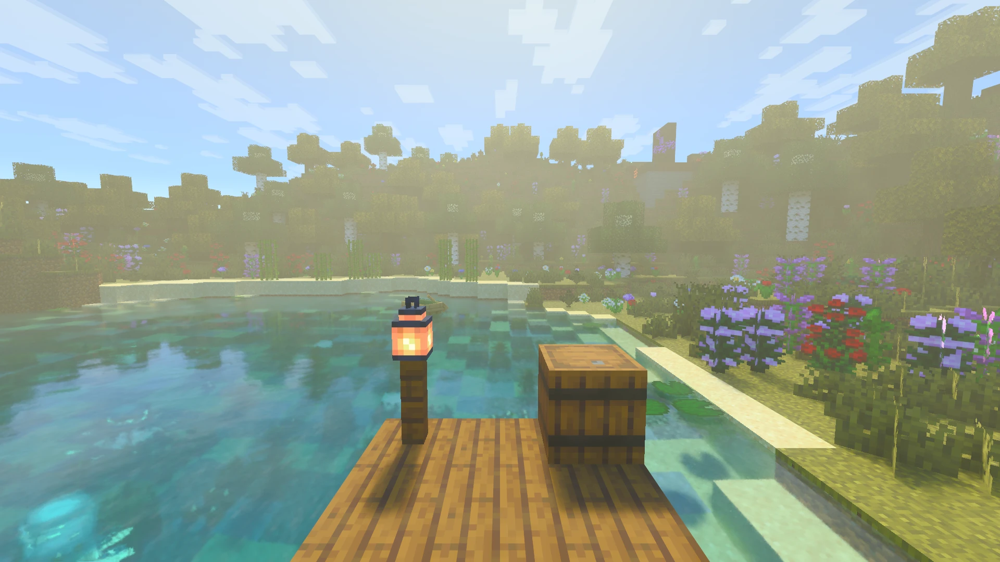

[← Back to index](README.md)

# Upscalers, frame generation and Reflex

Radiante traces the world below screen resolution and an upscaler brings it to full size. FSR is built in; DLSS and
XeSS are downloaded in game only if you want them, so the jar stays small.

| | FSR | DLSS | XeSS |
|---|---|---|---|
| Included | Built in | Downloaded, ~115 MB | Downloaded, ~73 MB |
| GPU | Any | NVIDIA | Intel Arc recommended; others if the driver passes XeSS's check |
| System | Windows, Linux | Windows, Linux | Windows |
| Pipeline | RT-FSR | RT-DLSS | RT-XeSS |
| Frame generation | 2x | Up to 4x on RTX 50 | — |

The pipelines themselves (and RT-Native, without an upscaler) are described in the
[Quality section](settings/quality-and-upscaling.md#the-pipelines).

## Installing DLSS or XeSS

**On first start**, NVIDIA GPUs are offered DLSS and Intel GPUs XeSS: **Download**, **Not now** or **Don't ask
again**. **Continue in the background** closes the window while it downloads.

| Offer | Download |
|---|---|
|  |  |

**Later, from the settings:** the **Pipeline** list shows what your GPU can use even when it is not installed, as
`RT-DLSS (Install)` or `RT-DLSS (Restart required)`. Picking one puts **Install**, **Update**, **Restart** or
**Delete** in the bottom bar.

> [!NOTE]
> Upscalers load when the game starts, so installing or deleting one is done outside a world and always ends in a
> restart.

After the restart, the first menu asks whether to switch to the new pipeline. If you keep the current one, pick
**RT-DLSS** or **RT-XeSS** in the Pipeline list later. When a Radiante update brings a newer DLSS or XeSS, the same
window offers the update; the installed one keeps working meanwhile.

Files live in the game's `radiante/` folder and are checked against their SHA-256 before use. If a download fails
(usually a firewall, proxy or no connection), FSR keeps working: retry from the settings.

## Comparison

The same view with each upscaler. FSR and no upscaler also draw a clearer sky, so judge the textures.

| DLSS Quality | DLSS Ultra Performance |
|---|---|
|  |  |
| **FSR 3** | **No upscaler** |
|  |  |

## Frame generation

Generates extra frames between the rendered ones: smoother motion on a high refresh rate monitor, at the cost of some
latency. It is in the Quality section and applies without a restart.

| Type | GPU | Up to |
|---|---|---|
| **DLSS** | NVIDIA, with DLSS installed | 4x on RTX 50, less on older cards |
| **FSR** | Any, with any upscaler | 2x |
| **Auto** (default) | DLSS when the GPU supports it, FSR otherwise | |

It does not force V-Sync. It is not available while **HDR Output** is on.

<!-- Screenshot pending: the F3 overlay showing real vs. generated FPS -->

## NVIDIA Reflex

Keeps the CPU from queuing frames ahead of the GPU, so your input reaches the screen sooner. Most noticeable with
frame generation; the two together are the recommended combination. Needs an NVIDIA GPU with a recent driver
(`VK_NV_low_latency2`); elsewhere the setting does not show. Works on Windows and Linux, with any pipeline, without a
restart.
