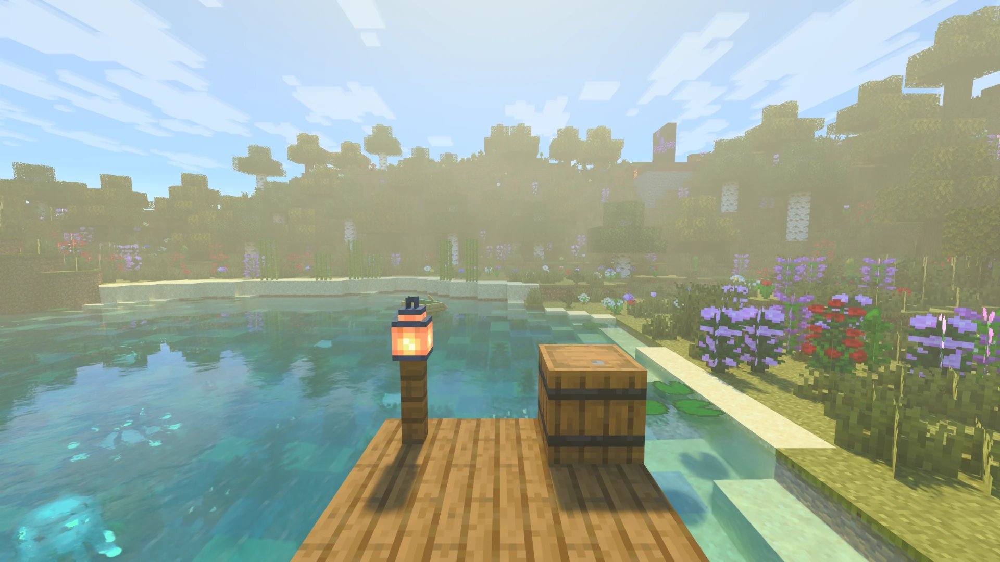

# Documentación de Radiante

Idiomas: **ES** · [EN](../en/README.md)

Radiante es un mod de path tracing para Minecraft Java. Estas páginas describen la versión para 26.3; las de 26.2 y
26.4 funcionan igual.

## Para jugar

| Página | Qué cubre |
|---|---|
| [Primeros pasos](primeros-pasos.md) | Requisitos, instalación, la primera vez, teclas |
| [Ajustes](opciones.md) | La pantalla de ajustes, presets y paquetes de shaders, con una página por sección |
| [Calidad y rendimiento](calidad-y-rendimiento.md) | Niveles de calidad, lo que más FPS cuesta, tirones y VRAM |
| [Escaladores, generación de fotogramas y Reflex](escaladores.md) | FSR, DLSS y XeSS, cómo instalarlos, generación de fotogramas, Reflex |
| [HDR](hdr.md) | Activar y calibrar HDR |
| [Bedrock RTX](bedrock-rtx.md) | Packs `.mcpack` de Bedrock y el aspecto de Bedrock RTX |
| [Distant Horizons](distant-horizons.md) | Terreno lejano, también trazado (experimental) |
| [Solución de problemas](solucion-de-problemas.md) | Pantallas al arrancar, escaladores, HDR, Linux, imagen lenta o mal |

## Ajustes por sección

[Calidad](opciones/calidad-y-escalado.md) · [Imagen](opciones/imagen.md) · [Iluminación](opciones/iluminacion.md) ·
[Cielo y Agua](opciones/cielo-niebla-agua.md) · [Rendimiento](opciones/rendimiento.md) ·
[Otros y Depuración](opciones/otros-y-depuracion.md)

## Crear cosas para Radiante

| Página | Qué cubre |
|---|---|
| [Hacer mods para Radiante](api.md) | La API pública: estado del trazado, el sol, tu propia geometría, tus opciones en los ajustes |
| [Crear un paquete de shaders](paquetes-de-shaders.md) | Tu propio aspecto con path tracing sobre Radiante PT |
| [Contribuir](../../CONTRIBUTING.es.md) | Compilar Radiante, probar un cambio, abrir un pull request |

## Limitaciones conocidas

- Los pipelines de FSR, XeSS y nativo tienen más ruido que DLSS con Reconstrucción de Rayos.
- AMD e Intel funcionan, pero están menos probados que NVIDIA.
- La generación de fotogramas no está disponible con HDR. XeSS es solo de Windows.
- El soporte de Distant Horizons es experimental.

Los errores e ideas están en [GitHub Issues](https://github.com/Gabrieli2806/Radiante/issues); hacia dónde va el
proyecto, en los [issues de roadmap](https://github.com/Gabrieli2806/Radiante/issues?q=is%3Aopen+label%3Aroadmap).

## Enlaces

[GitHub](https://github.com/Gabrieli2806/Radiante) · [Modrinth](https://modrinth.com/project/radiante) ·
[CurseForge](https://www.curseforge.com/minecraft/mc-mods/radiante) · [Discord](https://discord.gg/DhBbAzugZ9) ·
[Ko-fi](https://ko-fi.com/gabrieli2806)
