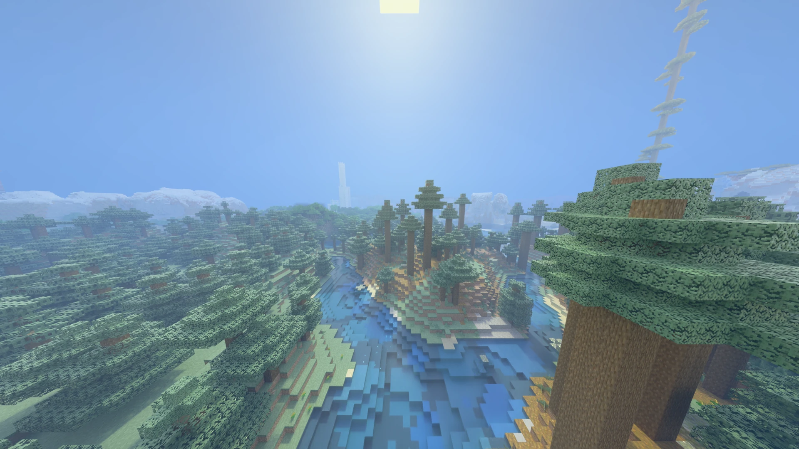

# Documentación de Radiante

Idiomas: **ES** · [EN](../en/README.md)

Radiante es un mod de trazado de rayos por hardware para Minecraft 26.3 (Fabric, NeoForge y Forge),
en Windows y Linux,
construido sobre el propio backend Vulkan de Minecraft en vez de crear un segundo dispositivo Vulkan
al lado. Su renderizador nativo es PrismRT. Del mismo código salen versiones para Minecraft 26.2
(Fabric, NeoForge y Forge) y para las snapshots de 26.4 (Fabric); estas páginas describen la
versión para 26.3.

Versión de esta documentación: **1.1.0**.

## Empezar

1. **[Requisitos](requisitos.md)** — sistema, GPU por fabricante, loader y Java.
2. **[Instalación](instalacion.md)** — pasos por loader (Fabric, NeoForge, Forge) y qué esperar al
   entrar por primera vez.
3. **[Escaladores](escaladores.md)** — FSR incluido; DLSS y XeSS se descargan en el juego.
4. **[Ajustes](opciones.md)** — cómo está organizada la pantalla de ajustes, el botón de restablecer
   valores, y el enlace a cada sección.

## Funciones a fondo

- **[Estilos de imagen y niveles de calidad](estilos-y-calidad.md)** — los niveles Baja/Media/Alta/Ultra,
  y los estilos Natural/Bedrock/Vívido.
- **[Resource packs y perfiles de Bedrock RTX](bedrock-rtx.md)** — usar un `.mcpack` de Bedrock, los
  perfiles Bedrock RTX (Mejorado) y Realista, y leer archivos de una instalación de Bedrock en el
  mismo PC.
- **[Distant Horizons](distant-horizons.md)** — soporte experimental de terreno lejano.
- **[HDR](hdr.md)** — salida en pantallas HDR, brillo máximo y blanco de papel.
- **[Generación de fotogramas y NVIDIA Reflex](frame-generacion-reflex.md)** — DLSS o FSR, y el
  modo de baja latencia.
- **[Rendimiento](rendimiento.md)** — qué cuesta más FPS y cómo ajustarlo a tu GPU.
- **[Linux](linux.md)** — glibc, drivers, launchers en Flatpak y qué mirar si no arranca.
- **[Problemas comunes](problemas.md)** — pantallas de "no disponible", cambios de API gráfica, y
  qué hacer si algo no funciona.

## Para desarrolladores

- **[Compilar y publicar](compilar.md)** — Windows, Linux, GitHub Actions y cómo sale una versión.
- **[Hacer mods para Radiante](api.md)** — la API pública: estado del trazado, el sol, geometría propia, ajustes.
- **[Hacer un paquete de shaders](paquetes-de-shaders.md)** — tu propio path tracer sobre Radiante PT.
- **[Opciones de complementos](complementos.md)** — cómo un mod pone sus opciones en los ajustes de Radiante.
- **[Cómo funciona PrismRT](../prismrt.md)** — la arquitectura del renderizador nativo, para quien contribuye (en inglés).

## Referencia de ajustes por sección

La pantalla de ajustes de Radiante (`F6` en el juego) tiene seis secciones. Cada una tiene su propia
página con todos sus controles, valor por defecto y qué hace cada uno:

| Sección en el juego | Documento |
|---|---|
| Calidad | [opciones/calidad-y-escalado.md](opciones/calidad-y-escalado.md) |
| Imagen | [opciones/imagen.md](opciones/imagen.md) |
| Iluminación | [opciones/iluminacion.md](opciones/iluminacion.md) |
| Cielo y Agua | [opciones/cielo-niebla-agua.md](opciones/cielo-niebla-agua.md) |
| Rendimiento | [opciones/rendimiento.md](opciones/rendimiento.md) |
| Otros | [opciones/otros.md](opciones/otros.md) |

## Qué es Radiante, en corto

- Trazado de rayos por hardware para el terreno: luz directa, sombras suaves e iluminación global,
  con 4 rebotes de luz por defecto, una caché de radiancia (SHaRC) para los más profundos, y ReSTIR
  para las luces de bloque.
- Cielo físico, niebla volumétrica (rejilla de froxels o por píxel), nubes
  volumétricas con sombras, suelo mojado, vidrio sin bordes.
- Ambiente de Bioma: el aire y el agua propios de cada bioma, de forma sutil, para biomas vanilla,
  de mods y de packs de Bedrock por igual.
- LabPBR (`_n`/`_s`) para bloques, entidades e ítems; resource packs `.mcpack` de Bedrock RTX,
  leídos con sus propios materiales; dos perfiles de render, Bedrock RTX (Mejorado) y Realista.
- Presets: guarda un aspecto, cambia entre aspectos, comparte uno como código.
- FSR incluido; DLSS y XeSS descargables. Generación de fotogramas DLSS o FSR y NVIDIA Reflex.
- Salida HDR, desenfoque de movimiento y profundidad de campo.
- Distant Horizons experimental.
- Corre sobre el dispositivo Vulkan que Minecraft ya crea. El jar pesa unos 15 MB.

## Limitaciones conocidas

- Los pipelines con NRD (FSR, XeSS, nativo) tienen algo más de ruido que DLSS Ray Reconstruction.
- AMD e Intel funcionan, pero están menos probados que NVIDIA.
- Generación de fotogramas y Reflex están probados en Fabric; en NeoForge y Forge corren el mismo
  código sin probar todavía. La generación no está disponible con HDR.
- XeSS solo en Windows. Tras instalar DLSS o XeSS, el siguiente inicio pregunta si cambiar a su
  pipeline; también puedes elegirlo después en los ajustes.
- Shader Execution Reordering es experimental (el agua puede verse blanca).
- Distant Horizons sigue siendo experimental: ver [distant-horizons.md](distant-horizons.md).

Los errores conocidos y las ideas se siguen en
[GitHub Issues](https://github.com/Gabrieli2806/Radiante/issues), y hacia dónde va el proyecto en
los [issues del roadmap](https://github.com/Gabrieli2806/Radiante/issues?q=is%3Aopen+label%3Aroadmap).

## Enlaces

- [GitHub](https://github.com/Gabrieli2806/Radiante) — código fuente;
  [issues](https://github.com/Gabrieli2806/Radiante/issues) para reportes de errores e ideas.
- [Modrinth](https://modrinth.com/project/radiante) · [CurseForge](https://www.curseforge.com/minecraft/mc-mods/radiante)
- [Discord](https://discord.gg/DhBbAzugZ9) — para preguntas, reportes y discutir cambios grandes antes de un PR.
- [Ko-fi](https://ko-fi.com/gabrieli2806)

## Licencia

GPL-3.0. Radiante comenzó como un fork de Radiance y MCVR, de LJIONG e Interstellarss.
