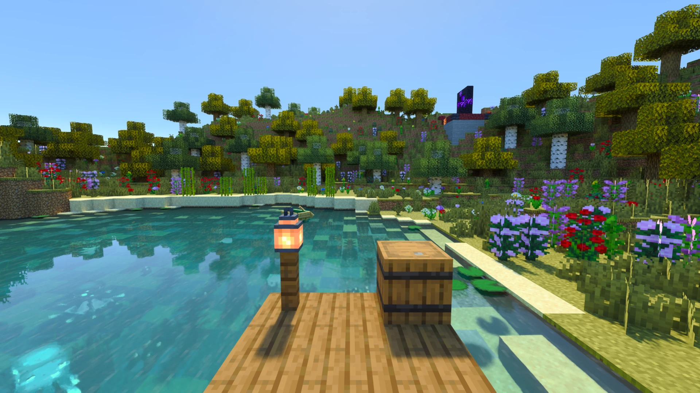
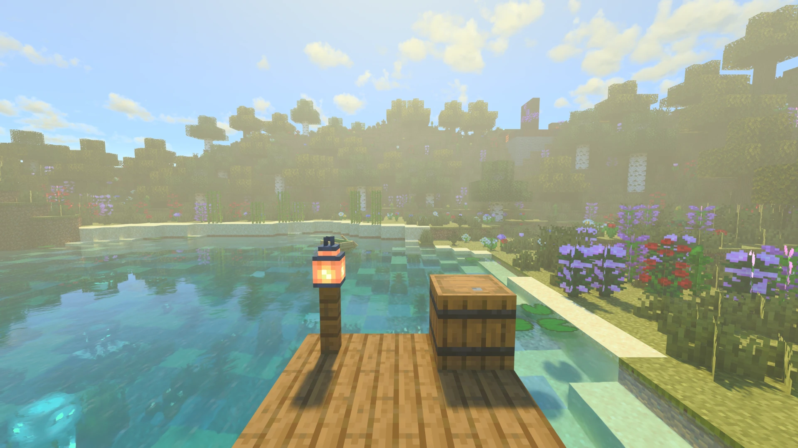

[← Volver al índice](README.md)

# Calidad y rendimiento

Cómo ganar FPS y qué ajusta cada nivel de calidad. Cada control de la sección Rendimiento, uno por uno, está en
[opciones/rendimiento.md](opciones/rendimiento.md).

## Empieza por el nivel de Calidad

El selector **Calidad**, arriba en la [sección Calidad](opciones/calidad-y-escalado.md), ajusta de una vez los
controles que más cuestan, en combinaciones ya probadas:

| Nivel | Modo del escalador | Niebla Volumétrica | Nubes | Distancia de render | Rebotes de Luz | Relieve de Texturas | Calidad de niebla |
|---|---|---|---|---|---|---|---|
| **Baja** | Ultra Performance | No | No | 8 chunks | 2 | No | 8 muestras |
| **Media** | Performance | No | Vanilla | 12 chunks | 2 | No | 8 muestras |
| **Alta** | Balanced | Sí | Vanilla | 16 chunks | 3 | Sí | 16 muestras |
| **Ultra** | Quality | Sí | Volumétricas | 24 chunks | 4 | Sí | 24 muestras |

El Muestreo de Luz de Bloques queda activado en todos los niveles. El modo se aplica al escalador que uses (Modo DLSS,
o Modo de Escalado con FSR y XeSS). Cambiar uno de estos controles a mano muestra **Personalizada**; una instalación
nueva también puede mostrarlo, porque los valores por defecto no coinciden con ningún nivel.

| Baja | Ultra |
|---|---|
|  |  |

## Lo que más cuesta

Medido en una escena, desde DLSS Ultra Performance (~150 fps) o Balanced (~80 fps):

| Control | Coste | Notas |
|---|---|---|
| **Modo del escalador** | Performance −45%, Quality −65% (desde Ultra Performance) | La palanca más grande. Tócala primero. |
| **Rebotes de Luz** (4 por defecto) | De 4 a 2 gana ~55% | Poco cambio visible. **Caché en Rebotes Profundos** (activado) y **Un rebote + caché** ahorran más. |
| **Distancia de render** | 24 chunks cuesta ~30% más que 16 | |
| **Niebla Volumétrica** | ~10% | 32 muestras cuestan ~30% más que 16. |
| **Muestreo de Luz de Bloques** | ~20% | Sin él hay mucho más ruido de noche y en cuevas. Suele merecer la pena dejarlo. |
| **Relieve de Texturas, Nubes** | Unos pocos % cada uno | Lo último que tocar. |

La Luz del Objeto en Mano y la Sombra en Primera Persona no cuestan nada medible.

### Las opciones de vídeo de Minecraft

Con el trazado de rayos activo, estas no cambian ni la imagen ni el tiempo por fotograma (medido el 2026-11-12,
activadas y desactivadas, el tiempo de GPU de cada pase igual dentro del ruido). Déjalas como prefieras para cuando el
trazado esté apagado:

- **Iluminación suave**: la luz trazada la sustituye.
- **Sombras de entidades**: no se dibuja la sombra redonda bajo los mobs; proyectan sus propias sombras.
- **Niveles de mipmap**, **Filtrado de texturas** y su anisotropía: el trazador elige el detalle de cada textura según
  su propia medida del tamaño del píxel sobre la superficie.
- **Transparencia mejorada**: los bloques transparentes se trazan en orden de todos modos.
- **Aparición gradual de chunks** y **Prioridad de actualización de chunks**: el mundo trazado construye sus chunks con
  sus propios hilos (ver Hilos de Chunks).
- **Hojas recortadas**: las hojas siguen dejando ver a través en ambos casos.

**Mezcla de biomas** sí se aplica: los colores de la hierba, el follaje y el agua son los de Minecraft.

## Problemas concretos

**Falta memoria de vídeo:** baja **Lotes de Chunks** (sección Rendimiento) y la distancia de render. La distancia de
Distant Horizons también usa VRAM.

**Tirones al volar o teletransportarse:** sube **Hilos de Chunks** si la CPU tiene margen, pero no más de la mitad de
tus núcleos lógicos ([por qué](opciones/rendimiento.md#por-qué-el-máximo-de-hilos-de-chunks-es-la-mitad-de-tus-núcleos)).
Si el tirón llega cuando se construyen los chunks, baja **Tamaño de Lote de Chunks**.

**El primer mundo tras una actualización tarda en abrir:** los shaders se compilan otra vez tras una actualización o
un driver nuevo, de unos segundos a un minuto. Radiante lo empieza en el menú principal con un aviso de progreso y lo
recuerda en `radiante/warmup.properties`. Borrar `radiante/cache` hace que se repita.

## Generación de fotogramas

Con 60+ FPS reales en un monitor de 144 Hz o más,
[la generación de fotogramas](escaladores.md#generación-de-fotogramas) da más fluidez sin bajar la calidad, a cambio
de algo de latencia que Reflex compensa. FSR funciona en cualquier GPU (2x); DLSS en NVIDIA (hasta 4x en RTX 50).

## Números de referencia

Un ajuste documentado para GPUs de gama media (una RTX 3060 o RX 6700 a 60 fps, 12 chunks) se sigue en el
[issue #21](https://github.com/Gabrieli2806/Radiante/issues/21). Comparte tus números en
[Discord](https://discord.gg/DhBbAzugZ9).
