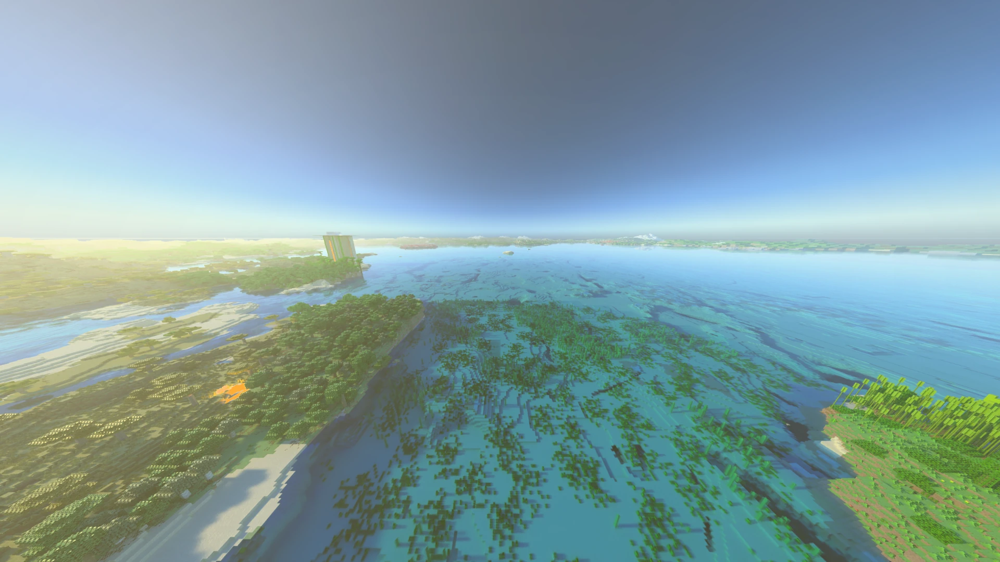

[← Volver al índice](README.md)

# Distant Horizons (experimental)

[Distant Horizons](https://modrinth.com/mod/distanthorizons) muestra terreno mucho más allá de la distancia de render
normal. Con él instalado, Radiante también traza ese terreno lejano: recibe luz, proyecta sombras y sale en los
reflejos. No hay nada que activar; sin Distant Horizons no cambia nada.

## Qué esperar

- **Un color por cara de bloque.** El terreno lejano no tiene texturas, así que se nota la franja donde acaba el
  terreno normal.
- **El coste crece con la distancia de Distant Horizons.** Cuanto más lejos genera, más traza la GPU y más memoria de
  vídeo usa.
- **Sin huecos al volar.** El terreno lejano se oculta columna a columna solo cuando ya se dibuja el terreno cercano
  que lo reemplaza.
- **Cerrar mientras genera.** Los hilos de Distant Horizons pueden impedir que el juego se cierre; Radiante lo
  detecta y deja que cierre. No hay que hacer nada.

Probado en Fabric y NeoForge: de día, de noche, con lluvia, nubes, bajo el agua, de 70 a 4000 bloques de altura,
activando y desactivando el trazado de rayos, volviendo a entrar y teletransportándose 4000 bloques.

Si algo se ve mal, baja la distancia de Distant Horizons y vuelve a mirar.
