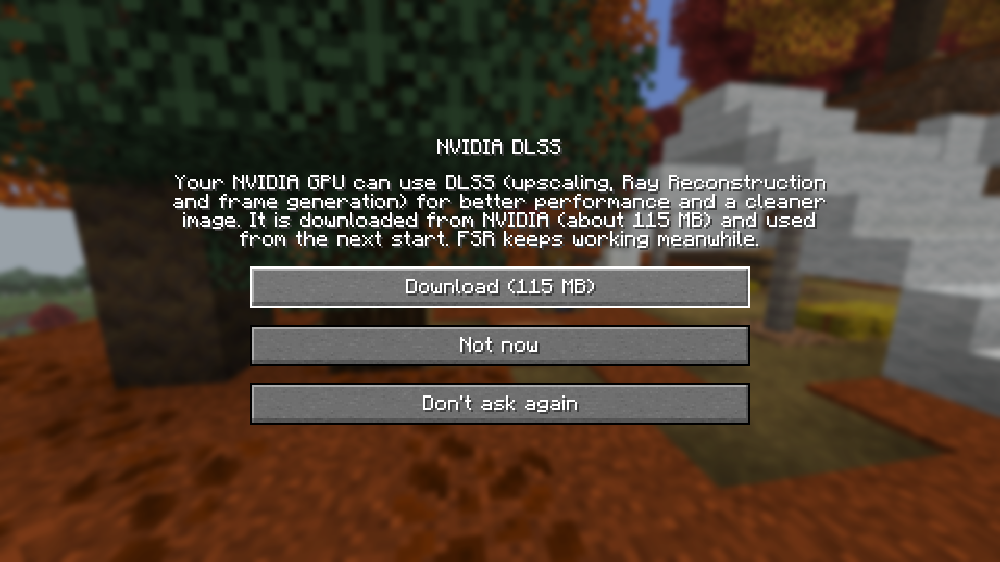
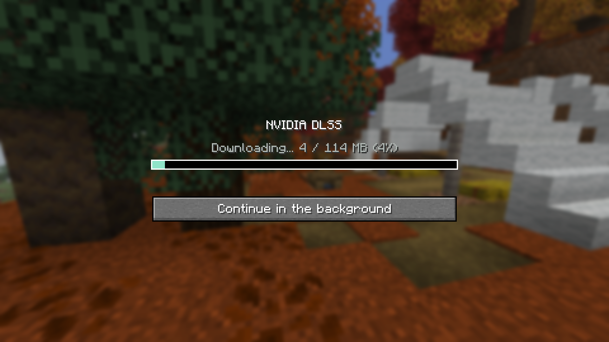
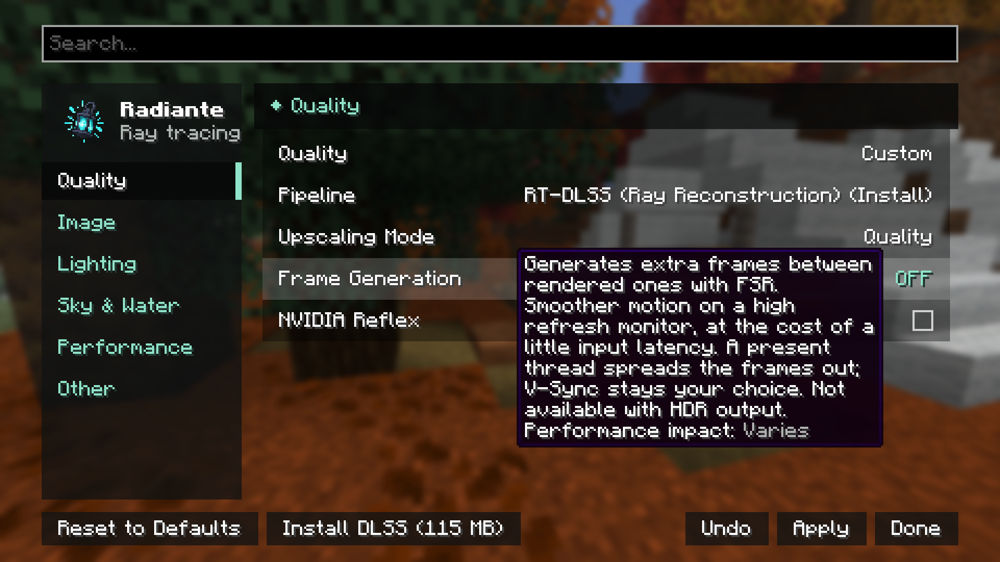
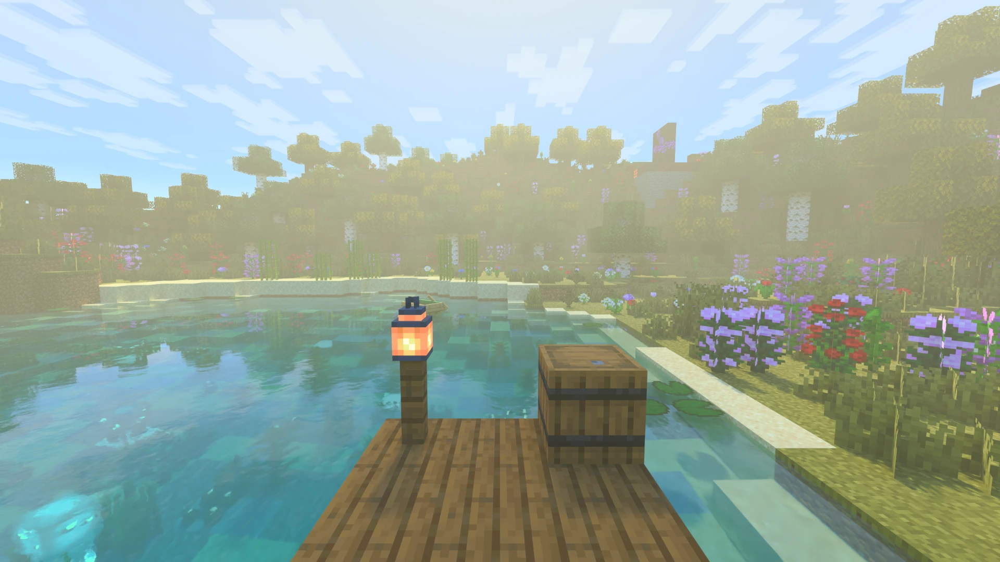
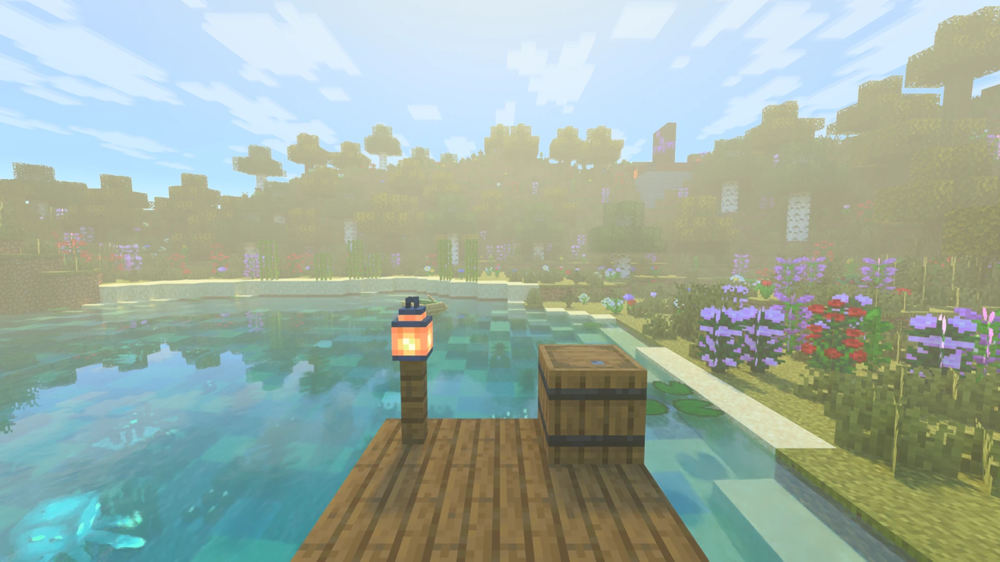
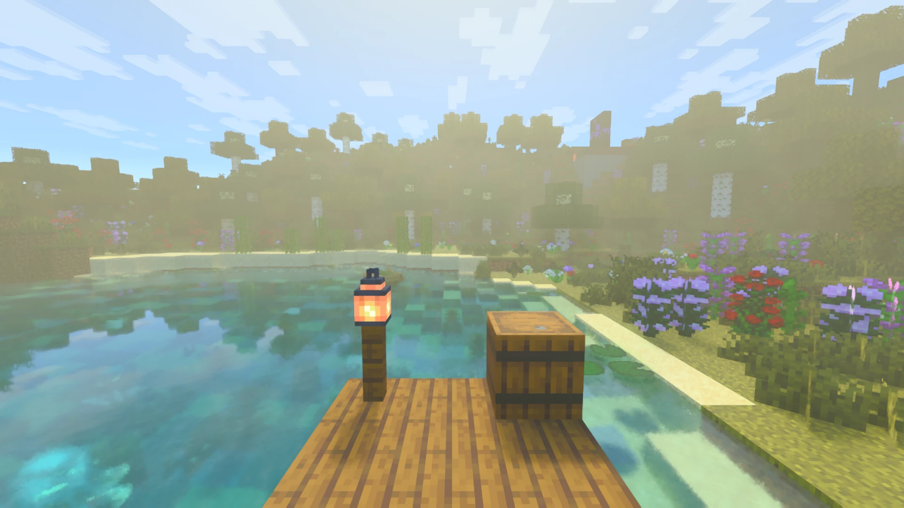
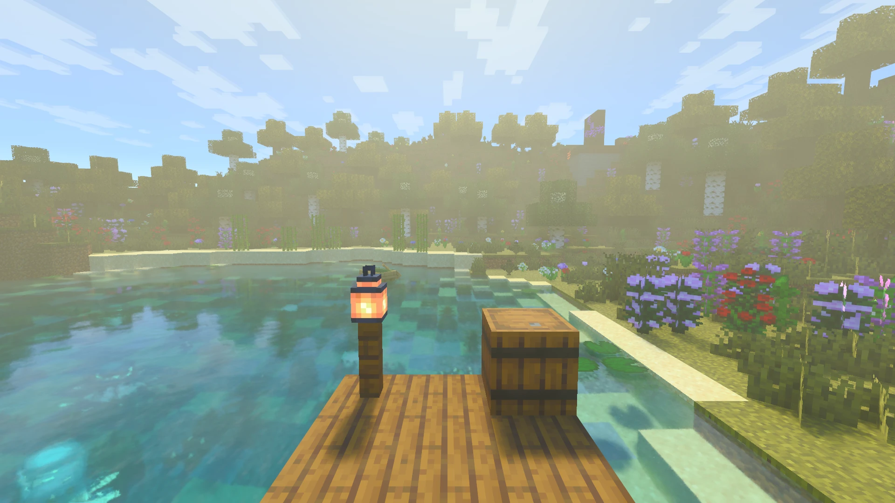

[← Volver al índice](README.md)

# Escaladores, generación de fotogramas y Reflex

Radiante traza el mundo por debajo de la resolución de pantalla y un escalador lo lleva al tamaño final. FSR viene
incluido; DLSS y XeSS se descargan en el juego solo si los quieres, así el jar sigue siendo pequeño.

| | FSR | DLSS | XeSS |
|---|---|---|---|
| Incluido | Sí | Se descarga, ~115 MB | Se descarga, ~73 MB |
| GPU | Cualquiera | NVIDIA | Intel Arc recomendado; otras si el driver pasa la comprobación de XeSS |
| Sistema | Windows, Linux | Windows, Linux | Windows |
| Pipeline | RT-FSR | RT-DLSS | RT-XeSS |
| Generación de fotogramas | 2x | Hasta 4x en RTX 50 | — |

Los pipelines (y RT-Native, sin escalador) se describen en la
[sección Calidad](opciones/calidad-y-escalado.md#los-pipelines).

## Instalar DLSS o XeSS

**La primera vez**, a las GPUs NVIDIA se les ofrece DLSS y a las Intel XeSS: **Descargar**, **Ahora no** o **No volver
a preguntar**. **Continuar en segundo plano** cierra la ventana mientras se descarga.

| Oferta | Descarga |
|---|---|
|  |  |

**Después, desde los ajustes:** la lista **Pipeline** muestra lo que tu GPU puede usar aunque no esté instalado, como
`RT-DLSS (Instalar)` o `RT-DLSS (Requiere reinicio)`. Al elegir uno, la barra de abajo ofrece instalar, actualizar,
reiniciar o borrar.

> [!NOTE]
> Los escaladores se cargan al arrancar el juego, así que instalar o borrar uno se hace fuera de un mundo y siempre
> termina en un reinicio.

Tras reiniciar, el primer menú pregunta si cambiar al pipeline nuevo. Si mantienes el actual, elige **RT-DLSS** o
**RT-XeSS** en la lista de Pipeline más tarde. Cuando una actualización de Radiante trae un DLSS o XeSS más nuevo, la
misma ventana ofrece actualizar; el instalado sigue funcionando mientras tanto.

Los archivos se guardan en la carpeta `radiante/` del juego y se comprueban con su SHA-256 antes de usarlos. Si una
descarga falla (casi siempre un firewall, un proxy o no hay conexión), FSR sigue funcionando: reintenta desde los
ajustes.

## Comparación

La misma vista con cada escalador. FSR y sin escalador también dibujan un cielo más claro, así que fíjate en las
texturas.

| DLSS Quality | DLSS Ultra Performance |
|---|---|
|  |  |
| **FSR 3** | **Sin escalador** |
|  |  |

## Generación de fotogramas

Genera fotogramas extra entre los renderizados: movimiento más fluido en un monitor de alta frecuencia, a cambio de
algo de latencia. Está en la sección Calidad y se aplica sin reiniciar.

| Tipo | GPU | Hasta |
|---|---|---|
| **DLSS** | NVIDIA, con DLSS instalado | 4x en RTX 50, menos en tarjetas anteriores |
| **FSR** | Cualquiera, con cualquier escalador | 2x |
| **Auto** (por defecto) | DLSS si la GPU lo soporta, si no FSR | |

No fuerza V-Sync. No está disponible con **Salida HDR** activada.

<!-- Captura pendiente: el F3 mostrando FPS reales y generados -->

## NVIDIA Reflex

Evita que la CPU encole fotogramas por delante de la GPU, así lo que haces llega antes a la pantalla. Se nota más con
generación de fotogramas; las dos juntas son la combinación recomendada. Necesita una GPU NVIDIA con un driver
reciente (`VK_NV_low_latency2`); en otras el ajuste no aparece. Funciona en Windows y Linux, con cualquier pipeline,
sin reiniciar.
