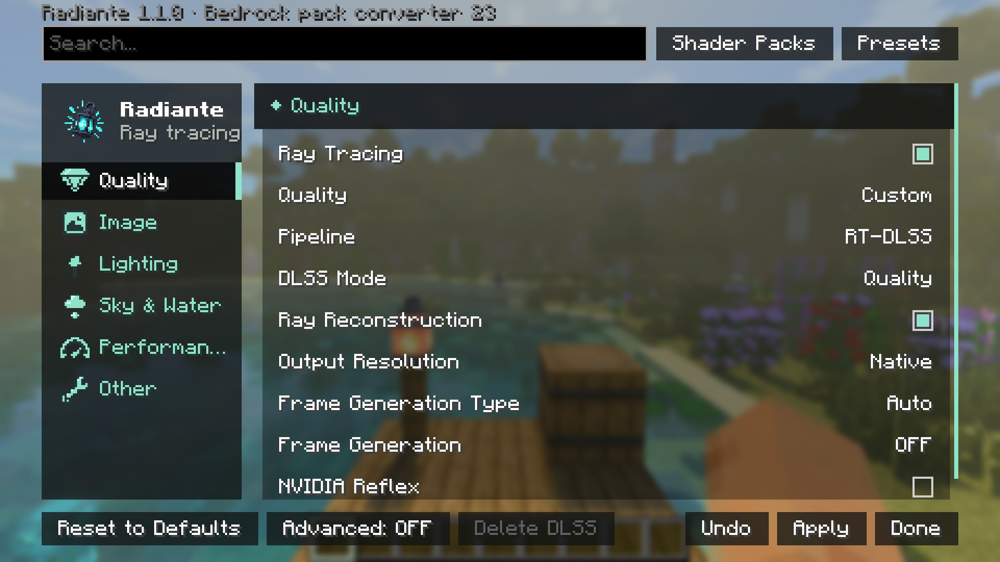

[← Volver al índice](README.md)

# Ajustes

Se abren con `F6` dentro de un mundo, o desde Opciones → Ajustes de vídeo → Radiante (también en el menú principal).

## Cómo funciona la pantalla

- **Las secciones** están a la izquierda; el panel de la derecha describe el ajuste bajo el ratón.
- **Aplicar** aplica los cambios y deja la pantalla abierta; **Listo** aplica y cierra; **Deshacer** descarta lo
  cambiado desde el último Aplicar. Los cambios se compilan en segundo plano con un aviso de progreso arriba a la
  derecha.
- **Buscar** encuentra un ajuste en cualquier sección por su nombre.
- **Avanzado** (abajo) muestra los controles finos de cada sección en grupos plegables, y añade la sección
  Depuración.
- **Restablecer valores** (abajo a la izquierda) devuelve todo a una instalación nueva. Mantén **Ctrl** para
  convertirlo en **Recompilar Shaders**, por si la imagen se ve mal tras un cambio.
- **Salida HDR** e instalar un escalador se aplican tras reiniciar. Al salir de la pantalla se listan los cambios
  pendientes.

El panel también muestra el **impacto en el rendimiento** de cada ajuste (Ninguno, Bajo, Medio, Alto o Variable), por
qué una fila en gris no hace nada ahora mismo, y qué otros ajustes reemplaza.

## Secciones

| Sección | Qué contiene |
|---|---|
| [Calidad](opciones/calidad-y-escalado.md) | Trazado de rayos sí/no, nivel de calidad, pipeline y escalador, resolución, generación de fotogramas, Reflex |
| [Imagen](opciones/imagen.md) | Estilo de imagen, mapeo de tonos, exposición, nitidez, HDR, desenfoque de movimiento, profundidad de campo |
| [Iluminación](opciones/iluminacion.md) | Brillos, translucidez, muestreo de luces de bloque, ReSTIR, luz en la mano, alcance de luz de entidades |
| [Cielo y Agua](opciones/cielo-niebla-agua.md) | Atmósfera, nubes, estrellas, sol, lluvia, vidrio, ambiente de bioma, niebla, agua |
| [Rendimiento](opciones/rendimiento.md) | Rebotes de luz, reflejos, caché, parallax, construcción de chunks |
| [Otros y Depuración](opciones/otros-y-depuracion.md) | Contorno de bloque, overlays de otros mods; vistas de depuración y logs (Avanzado) |
| *El nombre de un paquete de shaders* | Los ajustes propios de ese paquete, cuando se usa uno que no es Radiante PT |
| Complementos | Opciones de mods hechos sobre Radiante ([API](api.md#radianteaddons)) |

Un ajuste solo aparece cuando el pipeline, la GPU o el paquete de shaders lo soportan: Modo DLSS solo con RT-DLSS,
Reflex solo en NVIDIA, generación de fotogramas no con HDR. Si algo de aquí no está en tu pantalla, es por eso.

## Presets

**Presets**, junto a la búsqueda, guarda tus aspectos: guarda el actual, cambia con un clic, copia uno como código
para compartirlo o importa un código. Un preset guarda iluminación, cielo, niebla, agua, tono y efectos de cámara; el
escalador, la generación de fotogramas y el HDR se quedan como están.

<!-- Captura pendiente: la pantalla de Presets -->

## Paquetes de shaders

**Paquetes de shaders**, junto a Presets, elige el trazador:

- **Radiante PT** (por defecto): el aspecto de Bedrock RTX.
- **Pixelated Lighting** (incluido): sombras y reflejos en los píxeles de la textura.
- Los paquetes que añadas a `radiante/shaderpacks/` (**Abrir carpeta**), como `.zip` o como carpeta. Es la carpeta
  propia de Radiante, no la carpeta `shaderpacks/` que usan Iris y OptiFine.

Selecciona un paquete y pulsa **Usar**. Si no carga o no compila, Radiante vuelve a Radiante PT y muestra el error
(**Copiar error** para el autor del paquete). Cada paquete guarda sus propios ajustes, y un paquete que no sea
Radiante PT añade una sección con su nombre, con sus presets y ajustes.

<!-- Captura pendiente: la pantalla de Paquetes de shaders y la página de ajustes de un paquete -->

Para hacer el tuyo: [Crear un paquete de shaders](paquetes-de-shaders.md).

## Teclado y mando

| Teclado | Mando (Controlify) | Hace |
|---|---|---|
| Arriba / Abajo | Cruceta, stick izquierdo | Recorrer ajustes y botones |
| Izquierda / Derecha (Shift: ×10) | Stick derecho izquierda / derecha (×10) | Mover un slider, cambiar una lista |
| Enter / Espacio | A | Activar, pulsar, plegar un grupo |
| Tab / Shift+Tab | RB / LB | Sección siguiente / anterior |
| | B | Salir, como **Listo** |
| | X / Y | Aplicar / Deshacer |
