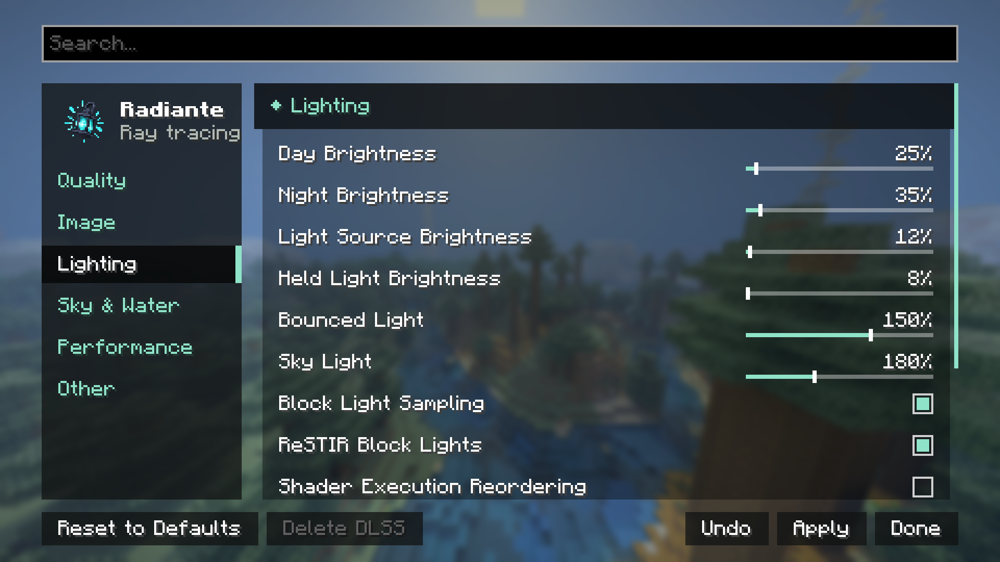

[← Ajustes](../opciones.md) · [Índice](../README.md)

# Iluminación

| Control | Rango | Por defecto | Qué hace |
|---|---|---|---|
| **Brillo del Día** | 0% – 400% | 25% | Luz del sol y del cielo de día. |
| **Brillo de la Noche** | 0% – 400% | 35% | Luz de la luna y del cielo de noche. |
| **Brillo de Fuentes de Luz** | 0% – 400% | 12% | Bloques que emiten luz: antorchas, lava, piedra luminosa… |
| **Brillo de Luz en la Mano** | 0% – 400% | 12% | Lo que llevas en la mano, su resplandor y la luz que proyecta. Requiere Luz del Objeto en Mano. |
| **Luz Rebotada** | 50% – 200% | 150% | Cuánta luz sigue tras rebotar. 100% es físicamente correcto; más alto llena los cuartos como Bedrock RTX. |
| **Luz del Cielo** | 50% – 400% | 180% | Cuánto ilumina el cielo abierto. |
| **Translucidez** | 0% – 200% | 100% | Luz del sol y la luna que atraviesa hojas y plantas desde atrás (brillan a contraluz con el sol bajo), y que rodea un poco el borde en sombra del hielo y la nieve, con un tono azul. 0% ilumina solo su lado soleado. No lanza rayos extra. Los paquetes de shaders pueden fijarla por superficie (`surface.mat.subSurface` en `hookSurface`). |
| **Muestreo de Luz de Bloques** | Activado / Desactivado | Activado | Cada superficie lanza un rayo de sombra directo a una luz cercana. Mucho menos ruido de noche y en cuevas. Requiere Emisión de Bloques (en [Rendimiento](rendimiento.md)). |
| **ReSTIR para Luces de Bloque** | Activado / Desactivado | Activado | Reutiliza la luz elegida por cada píxel entre fotogramas y vecinos. Mucho menos ruido en cuartos con muchas luces. Requiere Muestreo de Luz de Bloques. |
| **ReSTIR para Luz Rebotada** | Activado / Desactivado | Desactivado | ReSTIR GI: reutiliza el primer rebote de luz que encontró cada píxel entre fotogramas y píxeles vecinos. Menos ruido en cuartos y cuevas iluminados solo por luz rebotada; la luz que cambia (una antorcha rota, una puerta abierta) puede tardar un momento en seguirse. |
| **Reordenamiento de Ejecución (SER)** | Activado / Desactivado | Desactivado | Shader Execution Reordering: la GPU agrupa rayos parecidos. Pensado para RTX 40 o superior. Experimental: el agua puede verse blanca. |
| **Luz del Objeto en Mano** | Activado / Desactivado | Activado | Una antorcha o farol en cualquier mano ilumina alrededor. |
| **Sombra en Primera Persona** | Activado / Desactivado | Activado | Dibuja al jugador para sombras y reflejos en primera persona. |

## Luz Rebotada y Luz del Cielo también son parte del Estilo de Imagen

Cambian con el Estilo de Imagen (ver [Imagen](imagen.md) y
[estilos-y-calidad.md](../estilos-y-calidad.md)). Tocarlas a mano deja el estilo en Personalizado.

## Emisión HDR por bloque (Avanzado)

Abre **Iluminación → Avanzado → Emisión de bloques** y pulsa el color del bloque. El selector ofrece RGB,
exposición y campos numéricos **RGB HDR lineales**. **(1,1,1)** conserva la luz muestreada; **(0,0,0)** apaga la luz proyectada;
**(10,10,10)** multiplica por diez la luz proyectada. Cada canal admite hasta 65408. El tinte multiplica el color muestreado
de la textura. El brillo visible conserva el color y la intensidad del paquete, también en espejos y a través del
vidrio; su apariencia se modifica en el paquete. Listo prepara el cambio; Aplicar actualiza la luz y el terreno. Cancelar conserva el valor anterior;
Restablecer devuelve el blanco neutro.

La lista permite buscar fuentes integradas, texturas LabPBR/MER emisivas de paquetes activos, enredaderas y ajustes
guardados. Las texturas emisivas de un paquete también proyectan luz aunque el bloque no tenga nivel de luz en
Minecraft. Los ajustes se conservan al desactivar un paquete y se incluyen en los códigos compartidos. Los ajustes
antiguos de 0–1000% se convierten automáticamente a tres multiplicadores RGB iguales.

Un paquete puede incluir tintes de emisión del material en `assets/radiante/emission_tints.json`, por ejemplo
`{"minecraft:block/sea_lantern":[0.9,0.95,1.0]}`. Solo tiñen la luz proyectada, conservan la textura difusa y el brillo visible, y se multiplican por el ajuste del jugador.
Las luces dedicadas en mano conservan sus colores calibrados y reciben el tinte adicional del jugador.
