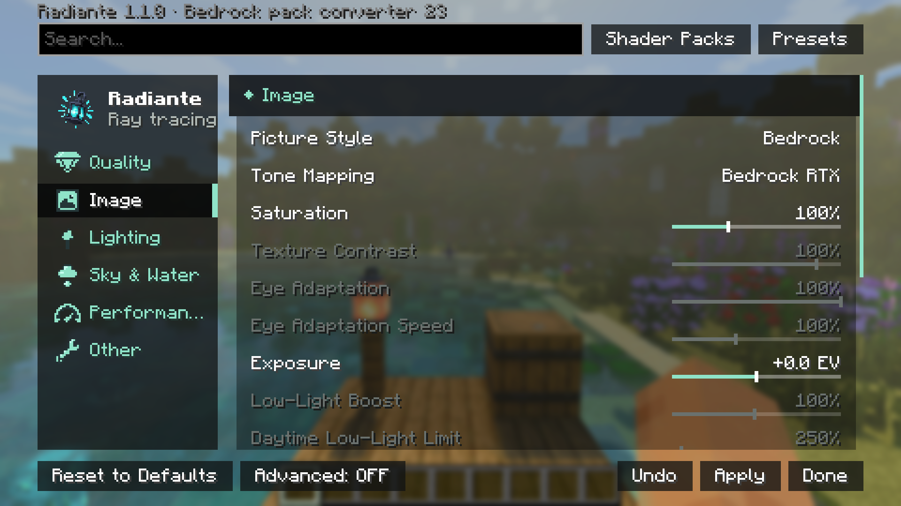
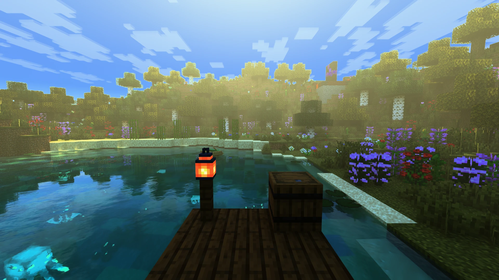
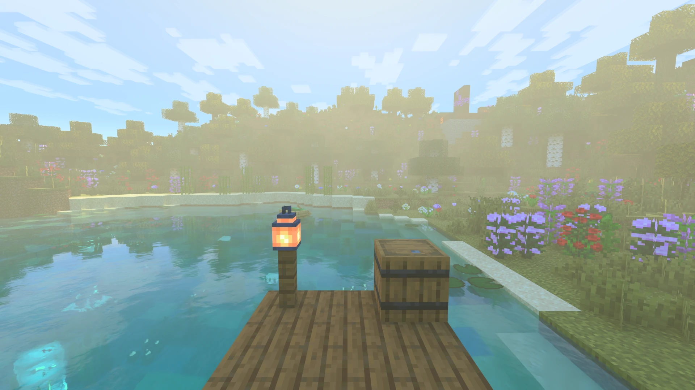
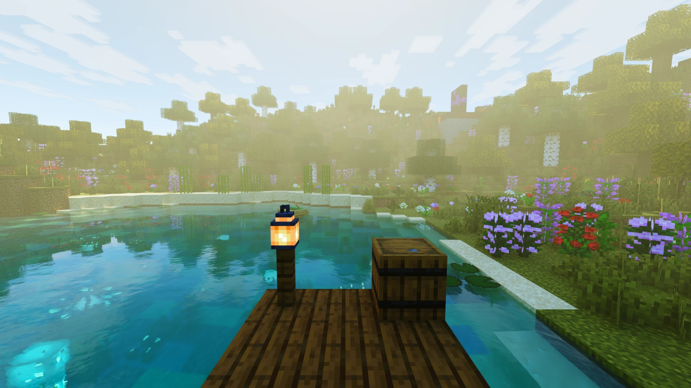

[← Ajustes](../opciones.md) · [Índice](../README.md)

# Imagen

Los valores por defecto son los de radiante-pt, el aspecto Bedrock RTX ([bedrock-rtx.md](../bedrock-rtx.md)).

| Control | Rango / Valores | Por defecto | Qué hace |
|---|---|---|---|
| **Estilo de Imagen** | Natural · Bedrock · Vívido · Personalizado | Bedrock | Ajusta la curva de tonos y la Saturación a la vez. Bedrock es el aspecto por defecto. Ver [Estilos de imagen](#estilos-de-imagen) abajo. |
| **Mapeo de Tonos** | Bedrock RTX · PBR Neutral · ACES · Reinhard | Bedrock RTX | Cómo se ajusta la luz intensa a lo que la pantalla puede mostrar. Bedrock RTX es la curva propia de Bedrock, construida con el histograma de la imagen; PBR Neutral mantiene los colores fieles; ACES es más cinematográfico y con más contraste; Reinhard es suave y plano. |
| **Saturación** | 50% – 200% | 100% | Qué tan colorida es la imagen. |
| **Contraste de Texturas** | 46% – 109% | 100% | Qué tan profundos y contrastados se ven los colores de bloques y entidades bajo la luz. 100% coincide con Bedrock RTX; menos da el aspecto más pálido y plano de versiones anteriores. En gris mientras Texturas sRGB Exactas (Avanzado) está activado, el valor por defecto. |
| **Adaptación del Ojo** | 0% – 100% | 100% | Cuánto se adapta la exposición a lo que miras. Menos mantiene los cuartos oscuros y el día brillante; 100% siempre iguala la imagen. En gris con la medición de Bedrock RTX (ver [abajo](#filas-de-exposición-en-gris)). |
| **Velocidad de Adaptación del Ojo** | 5% – 250% | 100% | Qué tan rápido sigue la exposición al pasar de la oscuridad a la luz o al revés. Menos deja ver cómo se ajustan los ojos por un momento; 100% es casi instantáneo. En gris con la medición de Bedrock RTX. |
| **Exposición** | -3.0 EV – +3.0 EV | +0.0 EV | Brillo general de la imagen, en pasos fotográficos. |
| **Refuerzo en Poca Luz** | 1% – 200% | 100% | Cuánto puede aclarar la exposición una escena oscura. Más deja ver mejor en cuevas y de noche; menos mantiene oscuro lo oscuro. 100% es el límite de Bedrock RTX. En gris con la medición de Bedrock RTX. |
| **Límite en Oscuridad de Día** | 50% – 3200% | 250% | Cuánto puede abrirse la exposición de día en un lugar oscuro. Bajo mantiene oscuros los cuartos cerrados; alto aclara cuartos iluminados solo por una ventana. En gris salvo que el modo de medición sea Luz incidente (Bedrock). |
| **Nitidez de FSR** | 0% – 100% | 70% | Cuánto afila FSR la imagen escalada. Más es más nítido pero puede mostrar halos en los bordes. Solo con RT-FSR. |
| **Salida HDR** | Activado / Desactivado | Desactivado | HDR en una pantalla HDR; los controles de brillo aparecen debajo al activarlo. Ver [HDR](../hdr.md). |
| **Desenfoque de Movimiento** | Activado / Desactivado | Desactivado | Difumina lo que se mueve en pantalla a lo largo de su movimiento, como una cámara. Cambiarlo recompila los shaders (un breve tirón al aplicar). |
| **Profundidad de Campo** | Activado / Desactivado | Desactivado | Mantiene nítido lo que miras y desenfoca lo mucho más cerca o más lejos, enfocando el centro de la pantalla. También recompila los shaders al cambiarlo. |
| **Fuerza de Motion Blur** | 10% – 220% | 100% | Qué tan largo es el barrido del Desenfoque de Movimiento: 100% es la mitad del tiempo de un fotograma, el obturador de una cámara de cine. Requiere Desenfoque de Movimiento. |
| **Desenfoque de Profundidad de Campo** | 25% – 400% | 100% | Cuánto se desenfoca lo que está fuera de foco. Requiere Profundidad de Campo. |
| **Rango de Enfoque** | 10% – 400% | 100% | Cuánto alrededor de lo que miras se mantiene nítido. Menos desenfoca antes, para un aspecto de primer plano. |
| **Enfoque Automático** | Activado / Desactivado | Activado | La Profundidad de Campo enfoca lo que esté en el centro de la pantalla. Apagado mantiene el foco en Distancia de Enfoque, para capturas. |
| **Distancia de Enfoque** | 1 – 256 bloques | 12 | A qué distancia queda nítida la imagen con Enfoque Automático apagado. |

Con la curva de tonos Bedrock RTX (la predeterminada) el mapeo de tonos es estilo Bedrock (una curva construida a partir del
histograma de la imagen) y la exposición se mide sobre la luz que llega a las superficies a la
vista, así que los sliders de exposición se comportan algo distinto que con las curvas PBR Neutral,
ACES o Reinhard.

## Filas de exposición en gris

Algunas filas salen en gris con los valores por defecto, y el panel de la derecha dice por qué:

- **Adaptación del Ojo**, **Velocidad de Adaptación del Ojo** y **Refuerzo en Poca Luz** salen en gris mientras el
  **Modo de Medición de Exposición** (Avanzado) es **Luz incidente, Bedrock RTX**, el valor por defecto: la medición
  de Bedrock RTX tiene sus propios límites y su propia velocidad.
- **Límite en Oscuridad de Día** sale en gris salvo que el modo de medición sea **Luz incidente (Bedrock)**.
- **Contraste de Texturas** sale en gris mientras **Texturas sRGB Exactas** (Avanzado) está activado, el valor por
  defecto.

## Estilos de imagen

**Estilo de Imagen** ajusta a la vez Mapeo de Tonos y Saturación, y nada más. Cambiar uno de ellos a mano muestra
**Personalizado**.

| Estilo | Mapeo de Tonos | Saturación | Aspecto |
|---|---|---|---|
| **Natural** | PBR Neutral | 100% | Colores fieles |
| **Bedrock** (por defecto) | Bedrock RTX | 100% | La curva propia de Bedrock RTX |
| **Vívido** | ACES | 130% | Más contraste y color |

| Natural | Bedrock | Vívido |
|---|---|---|
|  |  |  |

El Estilo de Imagen y la **Atmósfera** (en [Cielo y Agua](cielo-niebla-agua.md)) son independientes: la Atmósfera
elige de dónde salen los colores del cielo, el Estilo cómo se procesa la imagen final.

La Salida HDR y sus controles de brillo se explican en [HDR](../hdr.md).
