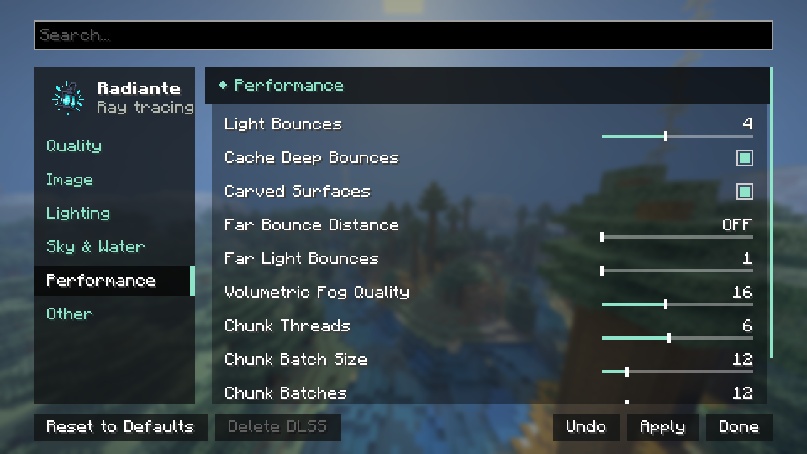

[← Ajustes](../opciones.md) · [Índice](../README.md)

# Rendimiento (categoría de ajustes)

> Esta página es la referencia de los controles que viven en la categoría "Rendimiento" de la
> pantalla de ajustes. Si buscas consejos generales para ganar FPS (qué preset elegir, cómo se
> compara tu GPU, el coste de Distant Horizons), esa es una página distinta:
> **[rendimiento.md](../rendimiento.md)**, en la raíz de la documentación.

| Control | Rango | Por defecto | Qué hace |
|---|---|---|---|
| **Rebotes de Luz** | 1 – 128 | 4 | Cuántas veces rebota la luz. De 4 a 2 ronda +50% FPS. Más de 4 cuesta mucho y es para GPUs potentes; espejos y vidrio claro reciben rebotes extra por su cuenta. |
| **Reflejos en Espejos** | 0 – 64 | 8 | Cuántos reflejos dentro de reflejos se trazan además de los Rebotes de Luz: espejos enfrentados, vidrio tras vidrio, agua vista en un espejo. Solo cuentan superficies casi perfectamente lisas, así que necesita un resource pack PBR; el agua y el vidrio siempre cuentan. Solo cuesta FPS donde hay espejos enfrentados. |
| **Transparencia del Portal** | 0% – 100% | 50% | Cuánto de la transparencia del resource pack conserva un portal del Nether. 100% es como lo dibuja el pack, 0% es opaco. |
| **Límite de Espejo** | 0% – 200% | 30% | Los metales al menos así de lisos se dibujan como espejos limpios y nítidos. 0% lo desactiva. |
| **Reflejos del Vidrio** | 0% – 200% | 100% | Cuánto cielo muestran las ventanas sobre lo que hay detrás. 0% es vidrio totalmente limpio. |
| **Caché en Rebotes Profundos** | Activado / Desactivado | Activado | Tras el primer rebote, la luz sale de la caché de radiancia en vez de seguir trazando, y las superficies rebotadas no buscan luces de bloque, como Bedrock RTX. Mucho más rápido con muchas luces; la luz rebotada puede verse algo más suave. |
| **Un rebote + caché** | Activado / Desactivado | Desactivado | Como Bedrock RTX: solo se traza un rebote de luz en todo, y el resto sale de la caché de radiancia donde cae. La mayor ganancia; la luz indirecta en zonas sin caché se ve algo más oscura por un momento. |
| **Tablero en vidrio/agua** | Activado / Desactivado | Desactivado | El agua y el vidrio trazan su reflejo o su refracción por píxel, alternando en tablero de ajedrez, en vez de ambos: un rayo por píxel en lugar de dos, como Bedrock RTX. |
| **Relieve de Texturas** (parallax) | Activado/Desactivado | Activado | Profundidad en texturas de resource packs con mapas de altura — ladrillos y piedras resaltan. Desactivado: texturas planas y algo más rápido. Sin un pack con mapas de altura, este control no cambia nada visualmente. |
| **Materiales de Packs Bedrock** | Activado / Desactivado | Activado | Packs Bedrock RTX (`.mcpack`): metal, rugosidad y lo que brilla se leen directo de los mapas MER del pack con todo su detalle, como en Bedrock, en vez de la copia convertida (las vetas de los minerales y los bordes de metal conservan sus reflejos). No afecta a packs Java. |
| **Calidad de Niebla Volumétrica** | 4 – 32 muestras | 16 | Muestras por rayo de la niebla volumétrica (ver [Cielo, Niebla y Agua](cielo-niebla-agua.md)). Menos es más rápido y algo más ruidoso; 32 cuesta cerca de un 30% más que 16. Solo aparece si tu pipeline soporta niebla volumétrica. |
| **Construcción de Chunks** | Automática · Manual | Automática | Automática ajusta la construcción de chunks a tu CPU para que no le quite recursos al juego mientras cargan chunks. Manual muestra los tres sliders de abajo. |
| **Hilos de Chunks** | 1 – la mitad de tus núcleos lógicos (máximo) | La mitad de tus núcleos lógicos | Hilos de CPU que convierten los chunks cargados en geometría de trazado de rayos. Más hilos cargan las áreas nuevas más rápido al volar o teletransportarte, pero compiten con el juego (y, en un solo jugador, con el servidor integrado generando esos mismos chunks) por la CPU. Bájalo si el juego se traba al cargar terreno; súbelo si los chunks tardan visiblemente en aparecer. |
| **Tamaño de Lote de Chunks** | 1 – 64 | 12 | Cuántas secciones de chunk se envían a la GPU en una sola construcción de la estructura de aceleración. Más alto llena el mundo más rápido pero puede causar picos de tiempo de fotograma al cargar; más bajo es más suave pero tarda más en ponerse al día. |
| **Lotes de Chunks** | 1 – 64 | 12 | Cuántas de esas construcciones pueden estar en curso en la GPU a la vez. Más alto carga más rápido en GPUs potentes y usa más memoria de vídeo; bájalo si notas tirones o te quedas sin VRAM. |
| **Emisión de Bloques** | Activado/Desactivado | Activado | Los bloques que emiten luz (antorchas, lava, piedra luminosa…) iluminan el mundo a su alrededor. Desactivarlo ahorra algo de rendimiento, pero entonces las fuentes de luz solo brillan ellas mismas — necesario para que "Muestreo de Luz de Bloques" (en [Iluminación](iluminacion.md)) tenga algo que muestrear. |

## Por qué el máximo de Hilos de Chunks es la mitad de tus núcleos

No es un número arbitrario: en una CPU de 24 hilos, medir con 20 hilos de construcción bajó los FPS
de 120 a unos 65 durante varios segundos después de cada teletransporte, mientras que 4 hilos
mantuvo el juego por encima de 110 FPS y cargó el área igual de rápido. Más hilos de los que tu CPU
puede dar sin quitárselos al renderizado solo hacen que el juego vaya peor, no que cargue antes.
